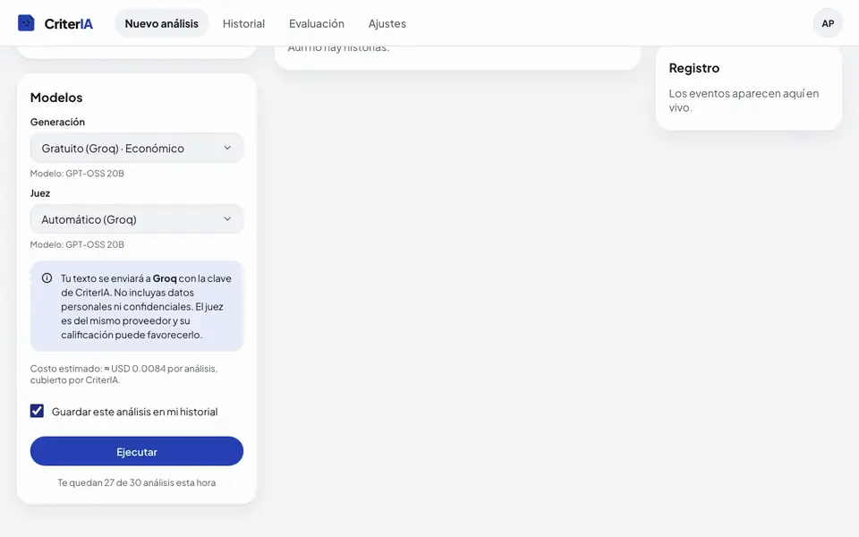
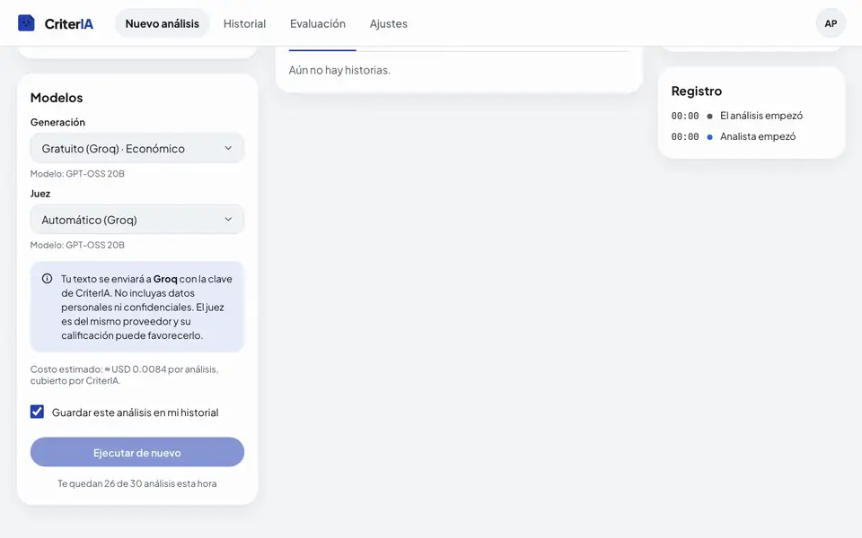
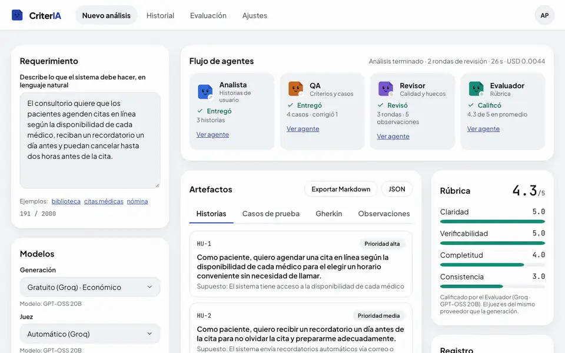
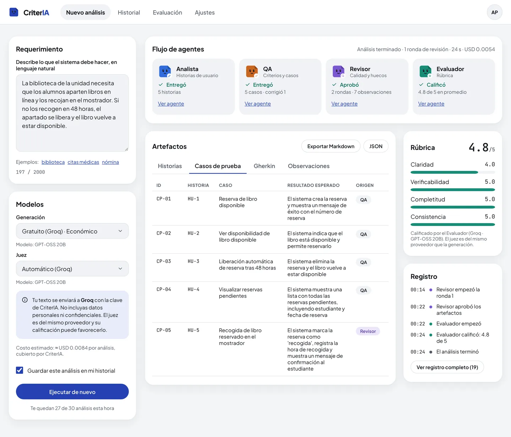
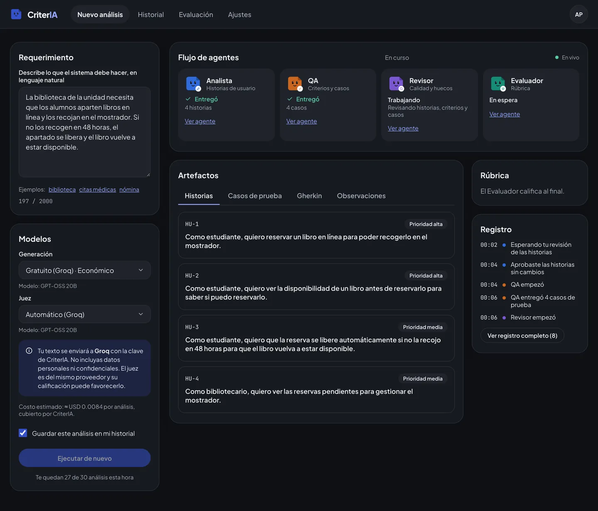
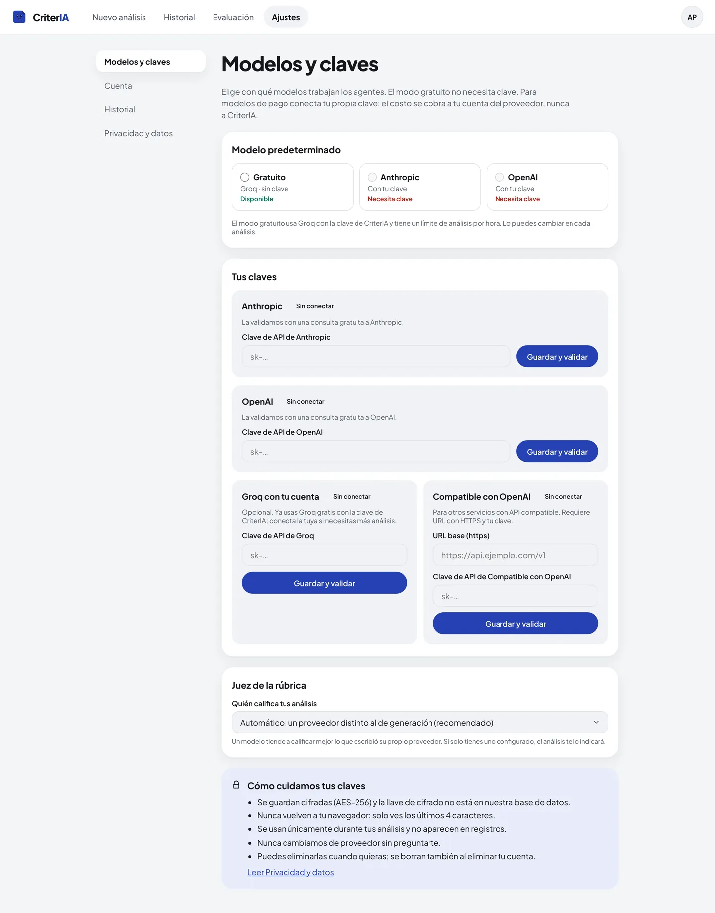
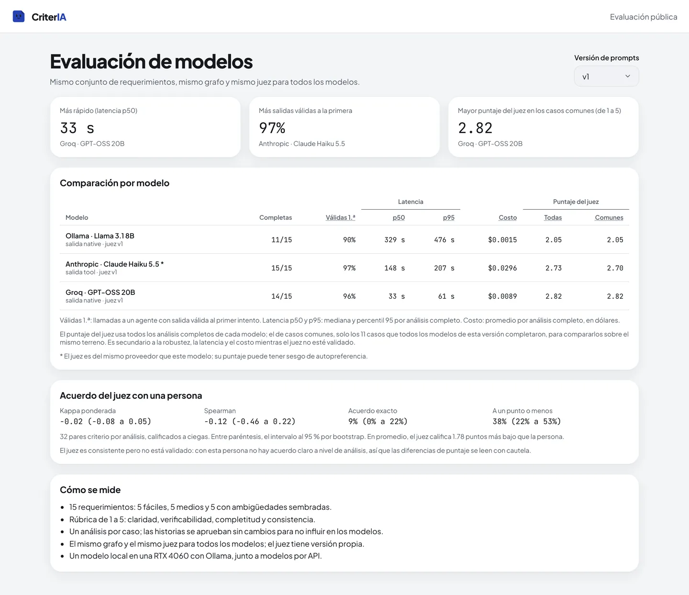
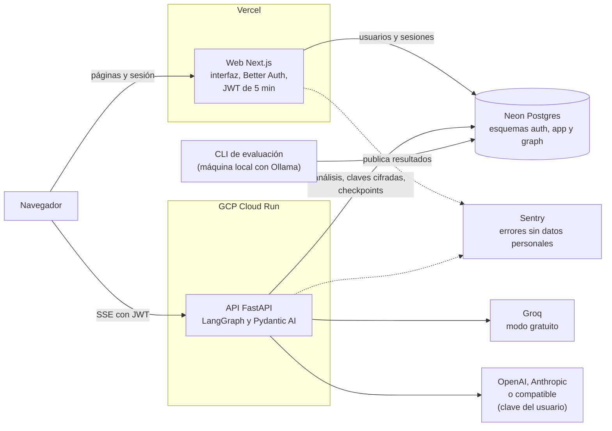

# CriterIA

CriterIA convierte un requerimiento escrito en lenguaje natural en historias de usuario, criterios de aceptación y casos de prueba, en tabla y en Gherkin. Cuatro agentes de IA se reparten el trabajo: uno redacta las historias, otro escribe las pruebas, un tercero revisa el resultado y pide correcciones, y el último lo califica con una rúbrica. Una persona aprueba o edita las historias antes de que se escriban las pruebas, y todo lo que se genera se presenta como una propuesta revisable. Está pensado para estudiantes y docentes de ingeniería de software, en particular de las materias de requisitos y de pruebas, y para desarrolladores que necesitan un primer borrador. Incluye un módulo de evaluación que compara modelos por API y locales con métricas reproducibles.

**App:** [criter-ia.vercel.app](https://criter-ia.vercel.app)



Un análisis real con el modo gratuito (Groq · GPT-OSS 20B), acelerado al doble. Las capturas con sesión se tomaron en un entorno local con modelos reales y límites por hora más amplios; las páginas públicas, en producción.

## Cómo funciona

### Los cuatro agentes

| Agente        | Recibe                                 | Entrega                                                                                                              |
| ------------- | -------------------------------------- | -------------------------------------------------------------------------------------------------------------------- |
| **Analista**  | El requerimiento                       | Historias de usuario (como / quiero / para), con prioridad y supuestos                                               |
| **QA**        | Las historias aprobadas por la persona | Criterios de aceptación y casos de prueba por historia, en tabla y en Gherkin (Dado / Cuando / Entonces)             |
| **Revisor**   | Historias, criterios y casos           | Observaciones (ambigüedad, inconsistencia o faltante) con destino y sugerencia; devuelve el trabajo hasta dos rondas |
| **Evaluador** | Los artefactos finales                 | Puntaje de 1 a 5 en claridad, verificabilidad, completitud y consistencia, con una justificación breve               |

Flujo: Analista → pausa para que la persona apruebe o edite → QA → Revisor (hasta dos rondas de corrección) → Evaluador. Cada agente es un agente de Pydantic AI con salida tipada y validada por esquema, y el flujo es un grafo de LangGraph ([agents.md](docs/agents.md)).

### La pausa humana

Después del Analista, el análisis se detiene. La persona puede aprobar las historias, editarlas, quitar o agregar alguna, o pedir otra versión al Analista (hasta dos veces). QA solo trabaja con las historias aprobadas. El estado del grafo queda en un checkpoint de Postgres, así que la pausa no depende de la instancia del servidor; el análisis espera hasta una hora.



### En vivo

El navegador abre un stream SSE directo contra la API y recibe eventos tipados de cada agente: cuándo empieza, qué entrega, qué observó el Revisor y cuánto costó. El análisis solo avanza mientras ese stream está abierto. Si la conexión se corta, la web se reconecta con el último evento recibido y el grafo sigue desde su último checkpoint ([ADR 0018](docs/adr/0018-run-lifecycle-bound-to-the-stream.md), [events.md](docs/events.md)).

El panel de cada agente muestra su prompt de sistema, el modelo y sus parámetros, su salida, los tokens, la latencia y el costo.



### Proveedores y claves

- **Modo gratuito.** Por defecto, los análisis corren en Groq (GPT-OSS 20B) con la clave del servidor, con un límite por persona (5 por hora y 20 por día) y un tope global diario en análisis y en dólares ([ADR 0019](docs/adr/0019-groq-developer-for-the-free-mode.md)).
- **Clave propia.** Para usar OpenAI, Anthropic, Groq con otra cuenta o un endpoint compatible con OpenAI, cada persona guarda su clave en «Modelos y claves». Se guarda cifrada y solo se muestran sus últimos 4 caracteres ([ADR 0016](docs/adr/0016-claves-por-usuario.md)).
- **Sin cambio de proveedor automático.** Antes de ejecutar, la interfaz dice a qué proveedor se envía el texto, con qué clave y cuánto costará. Si una clave falla, el análisis se detiene y ofrece «Usar el gratuito»; nunca envía los datos a otro proveedor por su cuenta.
- **Modo local.** Con Ollama, todo el flujo corre sin ninguna clave de API (ver [Desarrollo local](#modo-solo-local-con-ollama)).
- **Historial opcional.** Apagado por defecto. Un análisis sin historial vive solo en la pestaña y se puede exportar a Markdown o JSON.

En la API y en la documentación técnica, un análisis se llama _corrida_ (`run`).

## Evaluación de modelos (v1)

Tres modelos de generación con el mismo grafo, los mismos prompts y el mismo juez, sobre 15 requerimientos en español: 5 fáciles, 5 medios y 5 difíciles con 25 problemas sembrados. Los resultados se publican en el [tablero de evaluación](https://criter-ia.vercel.app/evaluacion).

| Modelo                           | Problemas detectados | Completas | Válidas a la primera | Latencia p50 | Costo por análisis (USD) |
| -------------------------------- | -------------------- | --------- | -------------------- | ------------ | ------------------------ |
| Anthropic · Claude Haiku 5.5 *   | 13 de 25 (52 %)      | 15 de 15  | 97 %                 | 148 s        | 0.0296                   |
| Groq · GPT-OSS 20B               | 8 de 25 (32 %)       | 14 de 15  | 96 %                 | 33 s         | 0.0089                   |
| Ollama · Llama 3.1 8B (RTX 4060) | 1 de 15 (7 %) †      | 11 de 15  | 90 %                 | 329 s        | 0.0015 (solo juez)       |

\* El juez (Claude Haiku) es del mismo proveedor. † Llama completó 3 de los 5 casos difíciles; su tasa no es directamente comparable.

- **Lectura.** Haiku detecta más problemas, sobre todo ambigüedades; GPT-OSS 20B es 4.5 veces más rápido y 3.3 veces más barato con robustez similar, por eso es el modelo del modo gratuito. Con 25 problemas, las diferencias son indicativas, no concluyentes.
- **El juez es consistente pero no está validado.** Al recalificar 10 análisis repite sus puntajes (kappa ponderada de 0.74), pero contra la calificación humana de 32 pares no hay acuerdo (kappa de −0.02) y califica 1.78 puntos más bajo. Por eso los puntajes del juez se reportan como métrica secundaria.
- **Limitaciones.** Una corrida por caso, un solo calificador humano (el autor), efecto techo en sus puntajes y un juez del mismo proveedor que uno de los modelos.

Detalle en el [reporte v1](docs/evaluation/report-v1.md) y el método completo en [evaluation.md](docs/evaluation.md).

## Capturas

|                                                                                                          |                                                                                                                  |
| -------------------------------------------------------------------------------------------------------- | ---------------------------------------------------------------------------------------------------------------- |
|  |  |
| Resultado: casos de prueba con su origen, rúbrica y registro                                             | En curso, en modo oscuro                                                                                         |
|      |                                           |
| Modelos y claves                                                                                         | Tablero de evaluación (producción)                                                                               |

A 390 px: [pausa de aprobación](docs/media/pausa-aprobacion-390.webp), [resultado en modo oscuro](docs/media/resultado-390-oscuro.webp) y [tablero en modo oscuro](docs/media/evaluacion-390-oscuro.webp). También: [inicio](docs/media/inicio.webp), [panel del agente](docs/media/panel-agente.webp) e [historial](docs/media/historial-oscuro.webp).

## Arquitectura



- **Monorepo** con la web (`apps/web`) y la API (`services/api`) separadas, cada una con su gestor de paquetes y su job en el CI ([ADR 0001](docs/adr/0001-monorepo.md)).
- **API hexagonal:** dominio puro, casos de uso, puertos y adaptadores para proveedores, Postgres, HTTP y CLI ([ADR 0002](docs/adr/0002-hexagonal-api.md)).
- **Web con Feature-Sliced Design,** con las capas verificadas por ESLint ([ADR 0003](docs/adr/0003-feature-sliced-web.md)).
- **Contrato compartido:** los esquemas Pydantic se exportan como JSON Schema y de ahí salen los tipos TypeScript de la web; el CI falla si no coinciden.
- **Datos:** Neon Postgres con esquemas separados y roles de mínimo privilegio. La API maneja la suspensión del cómputo de Neon sin fallar ([ADR 0023](docs/adr/0023-connections-closed-by-neon.md)).
- **Despliegue manual** con el mismo SHA: migraciones en un workflow con aprobación, la API en Cloud Run y la web en Vercel ([deploy.md](docs/deploy.md)).

Detalle en [architecture.md](docs/architecture.md), endpoints en [api.md](docs/api.md) y decisiones en [docs/adr/](docs/adr/README.md).

## Stack

| Parte                | Tecnología                                                                                                                  |
| -------------------- | --------------------------------------------------------------------------------------------------------------------------- |
| Web (`apps/web`)     | Next.js 16 con App Router, React 19, TypeScript estricto, Better Auth, zod, CSS Modules, Sentry                             |
| API (`services/api`) | Python 3.13, Pydantic AI, LangGraph, FastAPI, SQLAlchemy con psycopg, Alembic, PyJWT, pydantic-settings, Sentry             |
| Modelos              | Groq (GPT-OSS 20B) en el modo gratuito; OpenAI, Anthropic y endpoints compatibles con la clave del usuario; Ollama en local |
| Datos                | Neon Postgres (Postgres 16 en Docker en local y en el CI)                                                                   |
| Nube                 | GCP Cloud Run (API) y Vercel (web)                                                                                          |
| Calidad              | ESLint, Prettier, Vitest, Playwright con axe · Ruff, mypy, pytest, pip-audit                                                |
| CI                   | GitHub Actions, Dependabot, gitleaks y actionlint                                                                           |

## Seguridad

- **Sesión y acceso.** Better Auth con GitHub o correo y contraseña, en cookie httpOnly. La API recibe un JWT EdDSA de 5 minutos que la web guarda solo en memoria, y lo verifica con el JWKS de la web ([ADR 0008](docs/adr/0008-better-auth-and-api-jwt.md), [ADR 0020](docs/adr/0020-github-first-sign-in-without-email.md)).
- **Claves de los usuarios.** Cifradas con AES-256-GCM y llaves versionadas en Secret Manager. Nunca entran en eventos, checkpoints, logs ni respuestas ([api.md](docs/api.md#claves-propias)).
- **Navegador.** CSP estricta con nonce por petición, sin `unsafe-inline` ni `unsafe-eval` en producción, y cabeceras de seguridad ([ADR 0014](docs/adr/0014-nonce-based-csp.md)).
- **Entradas.** Validación por esquema, errores sin eco de lo enviado, límite de tamaño del cuerpo y CORS solo para el origen de la web. Las URLs que envía el usuario pasan por una protección SSRF que resuelve el DNS y se conecta a la IP validada.
- **Prompt injection.** El requerimiento y los artefactos llegan a los modelos como datos dentro de etiquetas, con los caracteres que podrían cerrarlas escapados. Los agentes no tienen herramientas con efectos laterales ([agents.md](docs/agents.md#datos-no-instrucciones)).
- **Uso y costo.** Límites por persona, tope global diario con reserva atómica y máximo de 2 instancias en Cloud Run ([api.md](docs/api.md#límites)).
- **Datos.** Roles de Postgres con mínimo privilegio, historial apagado por defecto y borrado en cascada al eliminar la cuenta. Sentry no recibe datos personales, cabeceras de autorización ni claves.
- **Secretos.** Van de 1Password directo a Secret Manager, Vercel y GitHub; ninguno vive en el repositorio, y gitleaks revisa todo el historial en cada push. Para reportar una vulnerabilidad, ver [SECURITY.md](SECURITY.md).

## Calidad

- **CI en cada push a `main`** ([ci.yml](.github/workflows/ci.yml)), con instalación desde los lockfiles:
  - **API:** Ruff (lint y formato), mypy estricto, pruebas unitarias y de integración contra Postgres 16, contrato al día y pip-audit.
  - **Web:** ESLint con las capas FSD, Prettier (código y documentación), typecheck, tipos generados al día, Vitest, build y pnpm audit.
  - **De punta a punta:** Playwright contra la API real con modelos simulados, Postgres y Mailpit; flujos completos y pantallas en escritorio y 390 px, claro y oscuro, con axe y sin violaciones de CSP.
  - **Imagen de la API:** build, migraciones desde la imagen y prueba de humo del contenedor.
  - **Repositorio:** actionlint, shellcheck y gitleaks sobre todo el historial.
- **Cobertura mínima del 90 %** en la API y en la web; el CI falla por debajo. Última medición: API 97.7 % en 684 pruebas de pytest, web 98.8 % de líneas en 238 pruebas de Vitest; además, 61 pruebas de Playwright.
- **Ninguna prueba llama a un modelo real.** Los agentes se prueban con los modelos simulados de Pydantic AI y el e2e usa `MODEL_BACKEND=fake`, que pasa por los prompts, validadores y grafo reales.
- **Dependabot** semanal para pnpm, uv, GitHub Actions y Docker. Las excepciones de auditoría se documentan en [audit-exceptions.md](docs/audit-exceptions.md).

## Estado

En producción desde el 13 de noviembre de 2026. En desarrollo: la vista oficina (los agentes en una oficina isométrica, [ADR 0012](docs/adr/0012-office-view-react-three-fiber.md)) y la versión 2 de los prompts, que se comparará contra la v1 con los mismos casos y el mismo juez.

## Estructura del repositorio

```
.
├── apps/web/            Next.js (FSD)
│   ├── app/             rutas del App Router (delgadas)
│   ├── e2e/             pruebas de Playwright con axe
│   ├── smoke/           prueba de navegador para producción (scripts/smoke-prod.sh)
│   ├── scripts/         despliegue manual a Vercel
│   └── src/             app, pages, widgets, features, entities, shared
├── services/api/        API en Python (hexagonal)
│   ├── src/criteria/    domain, application, ports, adapters, config
│   ├── prompts/         prompts de sistema: v1/ para los agentes y juez/v1/ para el Evaluador
│   ├── config/          modelos permitidos y precios
│   ├── contract/        JSON Schema de cuerpos y eventos, fuente de los tipos de la web
│   ├── db/              roles y esquemas de Postgres
│   ├── deploy/          valores no secretos de producción y limpieza de imágenes
│   ├── scripts/         despliegue manual a Cloud Run
│   ├── migrations/      Alembic
│   ├── examples/        requerimientos de ejemplo para la CLI
│   ├── eval/            casos de evaluación y resultados por versión
│   ├── tests/
│   ├── docker-compose.yml  Postgres local
│   └── Dockerfile
├── docs/                arquitectura, API, ADRs, despliegue, evaluación y medios del README
├── scripts/             prueba de humo de producción y verificaciones comunes de despliegue
└── .github/             CI, migraciones manuales de producción y Dependabot
```

## Desarrollo local

### Requisitos

- Node.js 26 LTS (fijado en `apps/web/.nvmrc`) y pnpm 12. La versión exacta está en `packageManager` de `apps/web/package.json`, y pnpm 10 o posterior cambia solo a ella; Node 26 ya no trae Corepack.
- [uv](https://docs.astral.sh/uv/) 0.13.7 exactamente: `services/api/pyproject.toml` lo exige en `[tool.uv] required-version` y uv se niega a correr con otra versión. uv instala Python 3.13 según `services/api/.python-version`.
- Docker, para el Postgres local, las pruebas de integración y la imagen de la API. `psql` para aplicar los roles.

### API

```bash
cd services/api
cp .env.example .env      # completa CREDENTIALS_KEYS (el comando para generarla está en el archivo)
uv sync --frozen
make db-up                # Postgres 16 en 127.0.0.1:5432
make db-setup             # roles, esquemas y contraseñas locales
make migrate              # Alembic como migrator_role
make run                  # http://127.0.0.1:8080/health
```

La CLI (`uv run criteria run …`) no necesita base de datos ni las variables de la API.

### Web

```bash
cd apps/web
cp .env.example .env.local   # completa BETTER_AUTH_SECRET; GitHub es opcional
pnpm install --frozen-lockfile
set -a && . ./.env.local && set +a && pnpm auth:migrate   # tablas de Better Auth en auth
pnpm dev                     # http://localhost:3000
```

Orden con la base local: `make db-up` y `make db-setup` en `services/api`, luego `pnpm auth:migrate` aquí y al final `make migrate` en la API (su migración 0004 apunta a `auth."user"`). Mientras `EMAIL_PROVIDER=none`, la API debe correr con `AUTH_REQUIRE_VERIFIED_EMAIL=false`. Para probar la verificación por correo, `EMAIL_PROVIDER=smtp` con `SMTP_URL=smtp://127.0.0.1:1025` y los correos en Mailpit (http://127.0.0.1:8025).

Si falta una variable obligatoria, la API y la web se niegan a arrancar y el mensaje dice cuál falta.

### Correr el grafo de agentes desde la terminal

La CLI corre el flujo completo (Analista → tu aprobación → QA → Revisor → Evaluador) e imprime cada evento. Desde `services/api`, con un `.env` que tenga al menos `APP_ENV`:

```bash
uv run criteria run --provider ollama --model llama3.1:8b --file examples/biblioteca.txt
```

| Opción                              | Qué hace                                                                                                                                                                                                     |
| ----------------------------------- | ------------------------------------------------------------------------------------------------------------------------------------------------------------------------------------------------------------ |
| `--provider`, `--model`             | Proveedor y modelo de generación; por defecto, `PROVIDER` y `GENERATION_MODEL` del `.env`                                                                                                                    |
| `--nivel`                           | `economico`, `equilibrado` o `maximo`, cuando no se indica `--model` (por defecto, `economico`); antes de empezar, la CLI muestra el costo estimado de la corrida                                            |
| `--judge-provider`, `--judge-model` | Proveedor y modelo del Evaluador. Si no se indican (ni `JUDGE_PROVIDER` o `JUDGE_MODEL`), se elige un proveedor distinto con acceso disponible en su nivel económico; si no hay otro, el mismo de generación |
| `--text "…"` o `--file ruta`        | El requerimiento (de 20 a 2,000 caracteres)                                                                                                                                                                  |
| `--auto-aprobar`                    | Aprueba las historias sin preguntar; sin esta opción, la CLI las muestra y pide aprobar, editar (abre `$EDITOR` con el JSON) o cancelar                                                                      |
| `--max-rondas N`                    | Rondas de corrección del Revisor, de 0 a 5; por defecto, `MAX_REVIEW_ROUNDS`                                                                                                                                 |
| `--json`                            | Un evento JSON por línea en la salida estándar; las preguntas van a la salida de errores                                                                                                                     |
| `--temperatura`, `--max-tokens`     | Parámetros del modelo                                                                                                                                                                                        |
| `--base-url`                        | URL `https` para `--provider openai_compatible`; la clave se toma de `CRITERIA_USER_API_KEY` en la sesión, nunca de un argumento                                                                             |
| `--clave-propia`                    | Usa `CRITERIA_USER_API_KEY` como clave del proveedor de generación (`openai`, `anthropic` o `groq`) en lugar de la del servidor                                                                              |

Hay tres requerimientos de ejemplo en `services/api/examples/`: `biblioteca.txt`, `citas-medicas.txt` y `nomina.txt`. La CLI sale con 0 si la corrida terminó, 1 si un agente falló, 2 por un error de uso o configuración y 130 si cancelaste. Si la clave falla por invalidez, saldo o límite, la corrida termina con su código y sugiere usar el gratuito; nunca cambia de proveedor sola.

### Modo solo local con Ollama

Con `PROVIDER=ollama` todo el flujo corre sin ninguna clave de API. Los modelos permitidos están en `services/api/config/models.toml`: `llama3.1:8b` (el predeterminado, elegido en F2b) y `qwen3:8b` (con el razonamiento apagado). Los dos usan salida JSON nativa restringida al esquema.

```bash
ollama pull llama3.1:8b
# en services/api/.env
APP_ENV=development
SERVER_KEY_PROVIDERS=ollama
PROVIDER=ollama
GENERATION_MODEL=llama3.1:8b
OLLAMA_BASE_URL=http://localhost:11434
```

Ollama puede estar en otra máquina de tu red local: basta con poner su dirección en `OLLAMA_BASE_URL`, por ejemplo `http://192.168.1.50:11434`. Esa URL la define quien opera el servidor, así que puede ser privada; la protección SSRF aplica solo a las URLs que envía el usuario. Si `OLLAMA_BASE_URL` no está definida, el proveedor `ollama` no se ofrece. Ollama no tiene autenticación: nunca expongas su puerto fuera de tu red local.

Las pruebas contra un Ollama real están excluidas por defecto y del CI:

```bash
OLLAMA_BASE_URL=http://localhost:11434 uv run pytest -m ollama --no-cov
```

### Imagen de la API

```bash
cd services/api
docker build -t criteria-api .
docker run --rm -e MIGRATION_DATABASE_URL=… criteria-api alembic upgrade head
docker run --rm --env-file .env -e HOST=0.0.0.0 -p 8080:8080 criteria-api
```

La misma imagen sirve la API y corre las migraciones. Corre con un usuario sin privilegios y toma el puerto de `PORT`, como lo inyecta Cloud Run. Desde el contenedor, `127.0.0.1` es el propio contenedor: en local, la base se alcanza con `host.docker.internal`.

## Scripts

API (`services/api`, con `make`):

| Script                                          | Qué hace                                                                                           |
| ----------------------------------------------- | -------------------------------------------------------------------------------------------------- |
| `make lint`                                     | Ruff check                                                                                         |
| `make format` / `make format-check`             | Ruff format, o solo verificación                                                                   |
| `make typecheck`                                | mypy en modo estricto                                                                              |
| `make test`                                     | pruebas unitarias con cobertura mínima del 90 %                                                    |
| `make test-integration`                         | toda la suite contra el Postgres local (crea y borra una base temporal), cobertura mínima del 90 % |
| `make audit`                                    | pip-audit sobre `uv.lock`                                                                          |
| `make contract`                                 | escribe `contract/schema.json` desde los esquemas Pydantic                                         |
| `make check`                                    | lint, formato, tipos, pruebas unitarias, auditoría y contrato al día                               |
| `make db-up` / `make db-setup` / `make migrate` | Postgres local, roles y migraciones                                                                |
| `make run`                                      | levanta la API                                                                                     |
| `uv run criteria run …`                         | corre el grafo de agentes en la terminal (ver arriba)                                              |

Web (`apps/web`, con `pnpm`):

| Script                                        | Qué hace                                                                                                                                                                                                                                                                                             |
| --------------------------------------------- | ---------------------------------------------------------------------------------------------------------------------------------------------------------------------------------------------------------------------------------------------------------------------------------------------------- |
| `pnpm dev` / `pnpm build` / `pnpm start`      | desarrollo, build y servidor de producción                                                                                                                                                                                                                                                           |
| `pnpm lint`                                   | ESLint, incluida la regla de capas FSD                                                                                                                                                                                                                                                               |
| `pnpm format` / `pnpm format:check`           | Prettier                                                                                                                                                                                                                                                                                             |
| `pnpm format:docs` / `pnpm format:docs:check` | Prettier sobre `docs/`, el README y SECURITY.md                                                                                                                                                                                                                                                      |
| `pnpm typecheck`                              | genera los tipos de Next.js y corre `tsc --noEmit`                                                                                                                                                                                                                                                   |
| `pnpm gen:api`                                | genera `src/shared/api/types.gen.ts` desde el contrato de la API                                                                                                                                                                                                                                     |
| `pnpm test`                                   | Vitest con cobertura mínima del 90 %                                                                                                                                                                                                                                                                 |
| `pnpm auth:migrate`                           | migraciones de Better Auth en el esquema `auth`                                                                                                                                                                                                                                                      |
| `pnpm e2e:build`                              | build para las pruebas de punta a punta (API en `127.0.0.1:8090`)                                                                                                                                                                                                                                    |
| `pnpm e2e`                                    | prepara una base `criteria_e2e` y corre Playwright: flujos, correo con Mailpit y pantallas en escritorio y 390 px, claro y oscuro, con axe y CSP. Levanta la API con `MODEL_BACKEND=fake`, dos servidores de la web y un sustituto local de GitHub; necesita Postgres y Mailpit del `docker compose` |
| `pnpm audit`                                  | `pnpm audit --audit-level=moderate`                                                                                                                                                                                                                                                                  |

Despliegue (manual, desde la raíz; ver [deploy.md](docs/deploy.md)):

| Script                                      | Qué hace                                                                                                     |
| ------------------------------------------- | ------------------------------------------------------------------------------------------------------------ |
| `gh workflow run migrate.yml -f sha=<sha>`  | migraciones de producción de Better Auth y Alembic, con aprobación                                           |
| `services/api/scripts/deploy.sh <sha>`      | construye la imagen `amd64` del SHA y la despliega en Cloud Run (`DRY_RUN=1` solo muestra los comandos)      |
| `apps/web/scripts/deploy.sh <sha>`          | alternativa con la CLI al despliegue de la web desde el panel de Vercel (Create Deployment con el mismo SHA) |
| `scripts/smoke-prod.sh <api_url> <web_url>` | prueba de humo: salud, 401, CORS, cabeceras, CSP en el navegador y tablero                                   |

## Variables de entorno

Las listas completas, con la fase en que se usa cada variable, están en [services/api/.env.example](services/api/.env.example) y [apps/web/.env.example](apps/web/.env.example). Nunca se versionan valores reales.

| Variable                                                                                   | Parte       | Obligatoria   | Uso                                                                                                                                                                          |
| ------------------------------------------------------------------------------------------ | ----------- | ------------- | ---------------------------------------------------------------------------------------------------------------------------------------------------------------------------- |
| `APP_ENV`                                                                                  | API         | Sí            | `development`, `test` o `production`; en producción se ocultan `/docs` y `/openapi.json`                                                                                     |
| `HOST`, `PORT`                                                                             | API         | No            | Interfaz y puerto (por defecto `127.0.0.1:8080`; la imagen usa `0.0.0.0`)                                                                                                    |
| `LOG_LEVEL`                                                                                | API         | No            | Nivel de log de uvicorn                                                                                                                                                      |
| `SENTRY_DSN`, `SENTRY_TRACES_SAMPLE_RATE`                                                  | API         | No            | Sentry se activa solo con DSN                                                                                                                                                |
| `PROVIDER`, `GENERATION_MODEL`                                                             | API         | No            | Proveedor y modelo de generación por defecto de la CLI                                                                                                                       |
| `JUDGE_PROVIDER`, `JUDGE_MODEL`                                                            | API         | No            | Proveedor y modelo del Evaluador; vacíos, la CLI elige un proveedor distinto si hay uno disponible                                                                           |
| `SERVER_KEY_PROVIDERS`                                                                     | API         | No            | Proveedores que pueden usar la clave del servidor, separados por comas; en producción, solo `groq`. Sin ella, toda corrida necesita la clave del usuario (`clave_requerida`) |
| `OPENAI_API_KEY`, `ANTHROPIC_API_KEY`, `GROQ_API_KEY`                                      | API         | No            | Claves del servidor. En producción solo existe la de Groq; las de OpenAI y Anthropic solo viven en un `.env` local para la evaluación                                        |
| `OLLAMA_BASE_URL`                                                                          | API         | No            | URL de Ollama; el proveedor `ollama` solo se ofrece con ella y con `ollama` en `SERVER_KEY_PROVIDERS`                                                                        |
| `PROVIDER_TIMEOUT_SECONDS`, `PROVIDER_TIMEOUTS`, `PROVIDER_MAX_RESPONSE_BYTES`             | API         | No            | Tiempo límite general y por proveedor (`ollama:180`), y tamaño máximo de respuesta                                                                                           |
| `PROMPT_VERSION`, `JUDGE_VERSION`                                                          | API         | No            | Versión de los prompts de los agentes y, por separado, la del juez (`v1`); el juez no cambia al comparar versiones de los agentes                                            |
| `MAX_REVIEW_ROUNDS`                                                                        | API         | No            | Rondas de corrección del Revisor (2)                                                                                                                                         |
| `PROMPTS_DIR`, `MODELS_FILE`                                                               | API         | No            | Rutas de los prompts y del catálogo; la imagen Docker las fija                                                                                                               |
| `DATABASE_URL`                                                                             | API         | Sí (servidor) | Postgres como `api_role`                                                                                                                                                     |
| `MIGRATION_DATABASE_URL`                                                                   | Migraciones | Sí (migrar)   | Postgres como `migrator_role`                                                                                                                                                |
| `WEB_ORIGIN`                                                                               | API         | Sí (servidor) | Único origen permitido por CORS                                                                                                                                              |
| `AUTH_JWKS_URL`, `AUTH_ISSUER`, `AUTH_AUDIENCE`                                            | API         | Sí (servidor) | Verificación de los JWT de la web                                                                                                                                            |
| `AUTH_ALGORITHMS`, `AUTH_VERIFIED_CLAIM`, `AUTH_JWKS_CACHE_SECONDS`, `AUTH_LEEWAY_SECONDS` | API         | No            | Algoritmos asimétricos (`EdDSA`), claim de correo verificado, caché del JWKS y tolerancia de reloj                                                                           |
| `CREDENTIALS_KEYS`, `CREDENTIALS_ACTIVE_KEY`                                               | API         | Sí (servidor) | Llaves versionadas de AES-256-GCM para las claves de los usuarios                                                                                                            |
| `CREDENTIAL_CHECKS_PER_HOUR`                                                               | API         | No            | Validaciones de claves por usuario y hora (10)                                                                                                                               |
| `USER_RUNS_PER_HOUR`, `USER_RUNS_PER_DAY`                                                  | API         | No            | Corridas por usuario (5 por hora, 20 por día)                                                                                                                                |
| `GLOBAL_DAILY_RUNS`, `GLOBAL_DAILY_BUDGET_USD`                                             | API         | No            | Cupo diario de corridas con claves del servidor (25 y 0.09 dólares por defecto; 11 y 0.10 en producción)                                                                     |
| `RUN_TTL_MINUTES`, `SSE_HEARTBEAT_SECONDS`, `MAX_REQUEST_BYTES`, `DATABASE_POOL_SIZE`      | API         | No            | Corridas abandonadas, latido del stream, tamaño del cuerpo y pool de conexiones                                                                                              |
| `TEST_DATABASE_ADMIN_URL`                                                                  | Pruebas     | No            | Superusuario de un Postgres de pruebas; sin ella, las pruebas de integración se omiten                                                                                       |
| `CRITERIA_USER_API_KEY`                                                                    | CLI         | No            | Clave propia para `openai_compatible` o, con `--clave-propia`, para el proveedor de generación; se exporta en la sesión, no va en `.env`                                     |
| `NEXT_PUBLIC_APP_ENV`                                                                      | Web         | Sí            | Entorno de la web                                                                                                                                                            |
| `NEXT_PUBLIC_API_URL`                                                                      | Web         | Sí            | URL de la API; también entra en `connect-src` de la CSP. En producción debe ser `https`                                                                                      |
| `NEXT_PUBLIC_SENTRY_DSN`                                                                   | Web         | No            | Sentry se activa solo con DSN                                                                                                                                                |
| `NEXT_PUBLIC_OFFICE_VIEW`                                                                  | Web         | No            | Muestra el cambio de vista; `false` hasta F9                                                                                                                                 |
| `NEXT_PUBLIC_CONTACT_URL`                                                                  | Web         | No            | Contacto de "Privacidad y datos" (`https` o `mailto:`); vacía enlaza el perfil de GitHub                                                                                     |
| `BETTER_AUTH_SECRET`, `BETTER_AUTH_URL`                                                    | Web         | Sí (servidor) | Secreto de sesión (32+ caracteres) y origen público de la web                                                                                                                |
| `AUTH_DATABASE_URL`                                                                        | Web         | Sí (servidor) | Postgres como `web_role` (solo el esquema `auth`)                                                                                                                            |
| `AUTH_JWT_ISSUER`, `AUTH_JWT_AUDIENCE`                                                     | Web         | No            | `iss` y `aud` del JWT para la API; vacías usan `BETTER_AUTH_URL`                                                                                                             |
| `EMAIL_PROVIDER`, `EMAIL_FROM`, `SMTP_URL`, `RESEND_API_KEY`                               | Web         | No            | `none` (sin verificación ni recuperación), `smtp` o `resend` ([ADR 0020](docs/adr/0020-github-first-sign-in-without-email.md))                                               |
| `GITHUB_CLIENT_ID`, `GITHUB_CLIENT_SECRET`                                                 | Web         | No            | "Continuar con GitHub"; sin ellas no aparece el botón                                                                                                                        |
| `GOOGLE_CLIENT_ID`, `GOOGLE_CLIENT_SECRET`                                                 | Web         | No            | Google preparado, sin botón                                                                                                                                                  |
| `AUTH_REQUIRE_VERIFIED_EMAIL`                                                              | API         | No            | `true` por defecto; `false` mientras la web no envíe correos                                                                                                                 |
| `MODEL_BACKEND`, `FAKE_MODEL_DELAY_MS`                                                     | API         | No            | `fake` solo para pruebas (exige `APP_ENV=test`)                                                                                                                              |

## Documentación

- [Arquitectura](docs/architecture.md)
- [Agentes y grafo](docs/agents.md)
- [Eventos de un análisis](docs/events.md)
- [API HTTP](docs/api.md)
- [Interfaz: espaciado y movimiento](docs/ui.md)
- [Decisiones de arquitectura (ADRs)](docs/adr/README.md)
- [Despliegue](docs/deploy.md)
- [Evaluación de modelos](docs/evaluation.md)
- [Reporte de evaluación v1](docs/evaluation/report-v1.md)
- [Overrides de auditoría de dependencias](docs/audit-exceptions.md)
- [Seguridad y reporte de vulnerabilidades](SECURITY.md)

## Licencia

Todos los derechos reservados. El código y la documentación se publican solo como referencia: no se permite usarlos, copiarlos, modificarlos ni distribuirlos sin autorización por escrito del autor. Consulta [LICENSE](LICENSE).

All rights reserved. Source code published for reference only.
