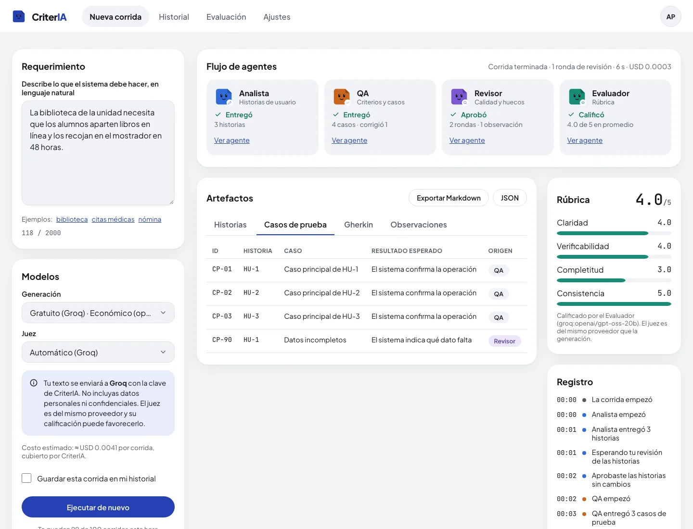

# CriterIA

CriterIA es un asistente multiagente que convierte un requerimiento escrito en lenguaje natural en historias de usuario, criterios de aceptación y casos de prueba. Un agente revisa el resultado y otro lo califica con una rúbrica. Incluye un módulo de evaluación que compara modelos, por API y locales, con métricas reproducibles.

Todo lo que genera es una propuesta: una persona aprueba o edita las historias antes de que se escriban las pruebas, y cada artefacto indica qué agente lo produjo.

El uso gratuito por defecto corre sobre Groq con la clave del servidor. Para usar modelos de pago (OpenAI, Anthropic, Groq con tu cuenta o un endpoint compatible con OpenAI), cada persona usa su propia clave de API. La herramienta nunca cambia de proveedor por su cuenta ([ADR 0016](docs/adr/0016-claves-por-usuario.md)).

**App desplegada:** pendiente (F6).



Capturas de las pruebas de punta a punta, con modelos simulados. También en [modo oscuro durante la pausa humana](docs/media/pausa-humana-oscuro.webp) y [a 390 px](docs/media/vista-clasica-390.webp).

## Para quién

- Estudiantes y docentes de ingeniería de software, en particular de materias de requisitos y de pruebas.
- Desarrolladores que quieren un primer borrador revisable de historias y casos de prueba.

## Los cuatro agentes

| Agente | Recibe | Entrega |
| --- | --- | --- |
| **Analista** | El requerimiento | Historias de usuario (como / quiero / para), con prioridad y supuestos |
| **QA** | Las historias aprobadas por la persona | Criterios de aceptación y casos de prueba por historia, en tabla y en Gherkin (Dado / Cuando / Entonces) |
| **Revisor** | Historias, criterios y casos | Observaciones (ambigüedad, inconsistencia o faltante) con destino y sugerencia; devuelve trabajo hasta dos rondas |
| **Evaluador** | Los artefactos finales | Puntaje de 1 a 5 en claridad, verificabilidad, completitud y consistencia, con justificación breve |

Flujo: Analista → pausa para que la persona apruebe o edite → QA → Revisor (con hasta dos rondas de corrección) → Evaluador.

## Estado

Fase F5 (evaluación v1): la web en Next.js está conectada a la API real, con registro, vista clásica, panel del agente, historial, "Modelos y claves", "Privacidad y datos" y el tablero de evaluación. La evaluación v1 comparó Claude Haiku 5.5, GPT-OSS 20B (Groq) y Llama 3.1 8B (local) sobre 15 requerimientos. Los resultados están en el [reporte v1](docs/evaluation/report-v1.md) y en el tablero. La vista oficina llega en F9 y el despliegue en F6.

## Stack

| Parte | Tecnología |
| --- | --- |
| Web (`apps/web`) | Next.js 16 con App Router, React 19, TypeScript estricto, Better Auth, zod, CSS Modules, Sentry |
| API (`services/api`) | Python 3.13, Pydantic AI, LangGraph, FastAPI, SQLAlchemy con psycopg, Alembic, PyJWT, pydantic-settings, Sentry |
| Datos | Neon Postgres (Postgres 16 en Docker en local y en el CI) |
| Nube | GCP Cloud Run (API) y Vercel (web) |
| Calidad | ESLint, Prettier, Vitest, Playwright con axe · Ruff, mypy, pytest, pip-audit |
| CI | GitHub Actions, Dependabot y gitleaks |

## Arquitectura

Monorepo con la web y la API separadas. La API sigue una arquitectura hexagonal (dominio, aplicación, puertos y adaptadores) y la web, Feature-Sliced Design. El navegador recibe los eventos de los agentes por SSE directamente desde la API, y la corrida solo avanza mientras ese stream está abierto. Los tipos de la web se generan desde el JSON Schema que exporta la API.

Detalle en [docs/architecture.md](docs/architecture.md), endpoints en [docs/api.md](docs/api.md) y decisiones en [docs/adr/](docs/adr/README.md).

## Estructura del repositorio

```
.
├── apps/web/            Next.js (FSD)
│   ├── app/             rutas del App Router (delgadas)
│   ├── e2e/             pruebas de Playwright con axe
│   └── src/             app, pages, widgets, features, entities, shared
├── services/api/        API en Python (hexagonal)
│   ├── src/criteria/    domain, application, ports, adapters, config
│   ├── prompts/         prompts de sistema: v1/ para los agentes y juez/v1/ para el Evaluador
│   ├── config/          modelos permitidos y precios
│   ├── contract/        JSON Schema de cuerpos y eventos, fuente de los tipos de la web
│   ├── db/              roles y esquemas de Postgres
│   ├── migrations/      Alembic
│   ├── examples/        requerimientos de ejemplo para la CLI
│   ├── tests/
│   ├── docker-compose.yml  Postgres local
│   └── Dockerfile
├── docs/                arquitectura, API, ADRs, despliegue y evaluación
└── .github/             CI y Dependabot
```

## Desarrollo local

### Requisitos

- Node.js 26 LTS (fijado en `apps/web/.nvmrc`) y pnpm 12 (lo selecciona Corepack o pnpm a partir de `packageManager`).
- [uv](https://docs.astral.sh/uv/) 0.13.7 exactamente: `services/api/pyproject.toml` lo exige en `[tool.uv] required-version` y uv se niega a correr con otra versión. uv instala Python 3.13 según `services/api/.python-version`.
- Docker, para el Postgres local, las pruebas de integración y la imagen de la API. `psql` para aplicar los roles.

### API

```bash
cd services/api
cp .env.example .env      # completa CREDENTIALS_KEYS (el comando para generarla está en el archivo)
uv sync --frozen
make db-up                # Postgres 16 en 127.0.0.1:5432
make db-setup             # roles, esquemas y contraseñas locales
make migrate              # Alembic como migrator_role
make run                  # http://127.0.0.1:8080/healthz
```

La CLI (`uv run criteria run …`) no necesita base de datos ni las variables de la API.

### Web

```bash
cd apps/web
cp .env.example .env.local   # completa BETTER_AUTH_SECRET; GitHub es opcional
pnpm install --frozen-lockfile
set -a && . ./.env.local && set +a && pnpm auth:migrate   # tablas de Better Auth en auth
pnpm dev                     # http://localhost:3000
```

Orden con la base local: `make db-up` y `make db-setup` en `services/api`, luego `pnpm auth:migrate` aquí y al final `make migrate` en la API (su migración 0004 apunta a `auth."user"`). Mientras `EMAIL_PROVIDER=none`, la API debe correr con `AUTH_REQUIRE_VERIFIED_EMAIL=false`. Para probar la verificación por correo, `EMAIL_PROVIDER=smtp` con `SMTP_URL=smtp://127.0.0.1:1025` y los correos en Mailpit (http://127.0.0.1:8025).

Si falta una variable obligatoria, la API y la web se niegan a arrancar y el mensaje dice cuál falta.

### Correr el grafo de agentes desde la terminal

La CLI corre el flujo completo (Analista → tu aprobación → QA → Revisor → Evaluador) e imprime cada evento. Desde `services/api`, con un `.env` que tenga al menos `APP_ENV`:

```bash
uv run criteria run --provider ollama --model llama3.1:8b --file examples/biblioteca.txt
```

| Opción | Qué hace |
| --- | --- |
| `--provider`, `--model` | Proveedor y modelo de generación; por defecto, `PROVIDER` y `GENERATION_MODEL` del `.env` |
| `--nivel` | `economico`, `equilibrado` o `maximo`, cuando no se indica `--model` (por defecto, `economico`); antes de empezar, la CLI muestra el costo estimado de la corrida |
| `--judge-provider`, `--judge-model` | Proveedor y modelo del Evaluador. Si no se indican (ni `JUDGE_PROVIDER` o `JUDGE_MODEL`), se elige un proveedor distinto con acceso disponible en su nivel económico; si no hay otro, el mismo de generación |
| `--text "…"` o `--file ruta` | El requerimiento (de 20 a 2,000 caracteres) |
| `--auto-aprobar` | Aprueba las historias sin preguntar; sin esta opción, la CLI las muestra y pide aprobar, editar (abre `$EDITOR` con el JSON) o cancelar |
| `--max-rondas N` | Rondas de corrección del Revisor, de 0 a 5; por defecto, `MAX_REVIEW_ROUNDS` |
| `--json` | Un evento JSON por línea en la salida estándar; las preguntas van a la salida de errores |
| `--temperatura`, `--max-tokens` | Parámetros del modelo |
| `--base-url` | URL `https` para `--provider openai_compatible`; la clave se toma de `CRITERIA_USER_API_KEY` en la sesión, nunca de un argumento |
| `--clave-propia` | Usa `CRITERIA_USER_API_KEY` como clave del proveedor de generación (`openai`, `anthropic` o `groq`) en lugar de la del servidor |

Hay tres requerimientos de ejemplo en `services/api/examples/`: `biblioteca.txt`, `citas-medicas.txt` y `nomina.txt`. La CLI sale con 0 si la corrida terminó, 1 si un agente falló, 2 por un error de uso o configuración y 130 si cancelaste. Si la clave falla por invalidez, saldo o límite, la corrida termina con su código y sugiere usar el gratuito; nunca cambia de proveedor sola.

### Modo solo local con Ollama

Con `PROVIDER=ollama` todo el flujo corre sin ninguna clave de API. Los modelos permitidos están en `services/api/config/models.toml`: `llama3.1:8b` (el predeterminado, elegido en F2b) y `qwen3:8b` (con el razonamiento apagado). Los dos usan salida JSON nativa restringida al esquema.

```bash
ollama pull llama3.1:8b
# en services/api/.env
APP_ENV=development
SERVER_KEY_PROVIDERS=ollama
PROVIDER=ollama
GENERATION_MODEL=llama3.1:8b
OLLAMA_BASE_URL=http://localhost:11434
```

Ollama puede estar en otra máquina de tu red local: basta con poner su dirección en `OLLAMA_BASE_URL`, por ejemplo `http://192.168.1.50:11434`. Esa URL la define quien opera el servidor, así que puede ser privada; la protección SSRF aplica solo a las URLs que envía el usuario. Si `OLLAMA_BASE_URL` no está definida, el proveedor `ollama` no se ofrece. Ollama no tiene autenticación: nunca expongas su puerto fuera de tu red local.

Las pruebas contra un Ollama real están excluidas por defecto y del CI:

```bash
OLLAMA_BASE_URL=http://localhost:11434 uv run pytest -m ollama --no-cov
```

### Imagen de la API

```bash
cd services/api
docker build -t criteria-api .
docker run --rm -e MIGRATION_DATABASE_URL=… criteria-api alembic upgrade head
docker run --rm --env-file .env -e HOST=0.0.0.0 -p 8080:8080 criteria-api
```

La misma imagen sirve la API y corre las migraciones. Corre con un usuario sin privilegios y toma el puerto de `PORT`, como lo inyecta Cloud Run. Desde el contenedor, `127.0.0.1` es el propio contenedor: en local, la base se alcanza con `host.docker.internal`.

## Scripts

API (`services/api`, con `make`):

| Script | Qué hace |
| --- | --- |
| `make lint` | Ruff check |
| `make format` / `make format-check` | Ruff format, o solo verificación |
| `make typecheck` | mypy en modo estricto |
| `make test` | pruebas unitarias con cobertura mínima del 90 % |
| `make test-integration` | toda la suite contra el Postgres local (crea y borra una base temporal), cobertura mínima del 90 % |
| `make audit` | pip-audit sobre `uv.lock` |
| `make contract` | escribe `contract/schema.json` desde los esquemas Pydantic |
| `make check` | lint, formato, tipos, pruebas unitarias, auditoría y contrato al día |
| `make db-up` / `make db-setup` / `make migrate` | Postgres local, roles y migraciones |
| `make run` | levanta la API |
| `uv run criteria run …` | corre el grafo de agentes en la terminal (ver arriba) |

Web (`apps/web`, con `pnpm`):

| Script | Qué hace |
| --- | --- |
| `pnpm dev` / `pnpm build` / `pnpm start` | desarrollo, build y servidor de producción |
| `pnpm lint` | ESLint, incluida la regla de capas FSD |
| `pnpm format` / `pnpm format:check` | Prettier |
| `pnpm typecheck` | genera los tipos de Next.js y corre `tsc --noEmit` |
| `pnpm gen:api` | genera `src/shared/api/types.gen.ts` desde el contrato de la API |
| `pnpm test` | Vitest con cobertura mínima del 90 % |
| `pnpm auth:migrate` | migraciones de Better Auth en el esquema `auth` |
| `pnpm e2e:build` | build para las pruebas de punta a punta (API en `127.0.0.1:8090`) |
| `pnpm e2e` | prepara una base `criteria_e2e` y corre Playwright: flujos, correo con Mailpit y pantallas en escritorio y 390 px, claro y oscuro, con axe y CSP. Levanta la API con `MODEL_BACKEND=fake`, dos servidores de la web y un sustituto local de GitHub; necesita Postgres y Mailpit del `docker compose` |
| `pnpm audit` | `pnpm audit --audit-level=moderate` |

## Variables de entorno

Las listas completas, con la fase en que se usa cada variable, están en [services/api/.env.example](services/api/.env.example) y [apps/web/.env.example](apps/web/.env.example). Nunca se versionan valores reales.

| Variable | Parte | Obligatoria | Uso |
| --- | --- | --- | --- |
| `APP_ENV` | API | Sí | `development`, `test` o `production`; en producción se ocultan `/docs` y `/openapi.json` |
| `HOST`, `PORT` | API | No | Interfaz y puerto (por defecto `127.0.0.1:8080`; la imagen usa `0.0.0.0`) |
| `LOG_LEVEL` | API | No | Nivel de log de uvicorn |
| `SENTRY_DSN`, `SENTRY_TRACES_SAMPLE_RATE` | API | No | Sentry se activa solo con DSN |
| `PROVIDER`, `GENERATION_MODEL` | API | No | Proveedor y modelo de generación por defecto de la CLI |
| `JUDGE_PROVIDER`, `JUDGE_MODEL` | API | No | Proveedor y modelo del Evaluador; vacíos, la CLI elige un proveedor distinto si hay uno disponible |
| `SERVER_KEY_PROVIDERS` | API | No | Proveedores que pueden usar la clave del servidor, separados por comas; en producción, solo `groq`. Sin ella, toda corrida necesita la clave del usuario (`clave_requerida`) |
| `OPENAI_API_KEY`, `ANTHROPIC_API_KEY`, `GROQ_API_KEY` | API | No | Claves del servidor. En producción solo existe la de Groq; las de OpenAI y Anthropic solo viven en un `.env` local para la evaluación |
| `OLLAMA_BASE_URL` | API | No | URL de Ollama; el proveedor `ollama` solo se ofrece con ella y con `ollama` en `SERVER_KEY_PROVIDERS` |
| `PROVIDER_TIMEOUT_SECONDS`, `PROVIDER_TIMEOUTS`, `PROVIDER_MAX_RESPONSE_BYTES` | API | No | Tiempo límite general y por proveedor (`ollama:180`), y tamaño máximo de respuesta |
| `PROMPT_VERSION`, `JUDGE_VERSION` | API | No | Versión de los prompts de los agentes y, por separado, la del juez (`v1`); el juez no cambia al comparar versiones de los agentes |
| `MAX_REVIEW_ROUNDS` | API | No | Rondas de corrección del Revisor (2) |
| `PROMPTS_DIR`, `MODELS_FILE` | API | No | Rutas de los prompts y del catálogo; la imagen Docker las fija |
| `DATABASE_URL` | API | Sí (servidor) | Postgres como `api_role` |
| `MIGRATION_DATABASE_URL` | Migraciones | Sí (migrar) | Postgres como `migrator_role` |
| `WEB_ORIGIN` | API | Sí (servidor) | Único origen permitido por CORS |
| `AUTH_JWKS_URL`, `AUTH_ISSUER`, `AUTH_AUDIENCE` | API | Sí (servidor) | Verificación de los JWT de la web |
| `AUTH_ALGORITHMS`, `AUTH_VERIFIED_CLAIM`, `AUTH_JWKS_CACHE_SECONDS`, `AUTH_LEEWAY_SECONDS` | API | No | Algoritmos asimétricos (`EdDSA`), claim de correo verificado, caché del JWKS y tolerancia de reloj |
| `CREDENTIALS_KEYS`, `CREDENTIALS_ACTIVE_KEY` | API | Sí (servidor) | Llaves versionadas de AES-256-GCM para las claves de los usuarios |
| `CREDENTIAL_CHECKS_PER_HOUR` | API | No | Validaciones de claves por usuario y hora (10) |
| `USER_RUNS_PER_HOUR`, `USER_RUNS_PER_DAY` | API | No | Corridas por usuario (5 por hora, 20 por día) |
| `GLOBAL_DAILY_RUNS`, `GLOBAL_DAILY_BUDGET_USD` | API | No | Cupo diario de corridas con claves del servidor (100 y 1 dólar) |
| `RUN_TTL_MINUTES`, `SSE_HEARTBEAT_SECONDS`, `MAX_REQUEST_BYTES`, `DATABASE_POOL_SIZE` | API | No | Corridas abandonadas, latido del stream, tamaño del cuerpo y pool de conexiones |
| `TEST_DATABASE_ADMIN_URL` | Pruebas | No | Superusuario de un Postgres de pruebas; sin ella, las pruebas de integración se omiten |
| `CRITERIA_USER_API_KEY` | CLI | No | Clave propia para `openai_compatible` o, con `--clave-propia`, para el proveedor de generación; se exporta en la sesión, no va en `.env` |
| `NEXT_PUBLIC_APP_ENV` | Web | Sí | Entorno de la web |
| `NEXT_PUBLIC_API_URL` | Web | Sí | URL de la API; también entra en `connect-src` de la CSP. En producción debe ser `https` |
| `NEXT_PUBLIC_SENTRY_DSN` | Web | No | Sentry se activa solo con DSN |
| `NEXT_PUBLIC_OFFICE_VIEW` | Web | No | Muestra el cambio de vista; `false` hasta F9 |
| `BETTER_AUTH_SECRET`, `BETTER_AUTH_URL` | Web | Sí (servidor) | Secreto de sesión (32+ caracteres) y origen público de la web |
| `AUTH_DATABASE_URL` | Web | Sí (servidor) | Postgres como `web_role` (solo el esquema `auth`) |
| `AUTH_JWT_ISSUER`, `AUTH_JWT_AUDIENCE` | Web | No | `iss` y `aud` del JWT para la API; vacías usan `BETTER_AUTH_URL` |
| `EMAIL_PROVIDER`, `EMAIL_FROM`, `SMTP_URL`, `RESEND_API_KEY` | Web | No | `none` (sin verificación ni recuperación), `smtp` o `resend` ([ADR 0020](docs/adr/0020-github-first-sign-in-without-email.md)) |
| `GITHUB_CLIENT_ID`, `GITHUB_CLIENT_SECRET` | Web | No | "Continuar con GitHub"; sin ellas no aparece el botón |
| `GOOGLE_CLIENT_ID`, `GOOGLE_CLIENT_SECRET` | Web | No | Google preparado, sin botón |
| `AUTH_REQUIRE_VERIFIED_EMAIL` | API | No | `true` por defecto; `false` mientras la web no envíe correos |
| `MODEL_BACKEND`, `FAKE_MODEL_DELAY_MS` | API | No | `fake` solo para pruebas (exige `APP_ENV=test`) |

## Documentación

- [Arquitectura](docs/architecture.md)
- [Agentes y grafo](docs/agents.md)
- [Eventos de una corrida](docs/events.md)
- [API HTTP](docs/api.md)
- [Decisiones de arquitectura (ADRs)](docs/adr/README.md)
- [Despliegue](docs/deploy.md)
- [Evaluación de modelos](docs/evaluation.md)
- [Reporte de evaluación v1](docs/evaluation/report-v1.md)
- [Overrides de auditoría de dependencias](docs/audit-exceptions.md)

## Licencia

Todos los derechos reservados. Consulta [LICENSE](LICENSE).
