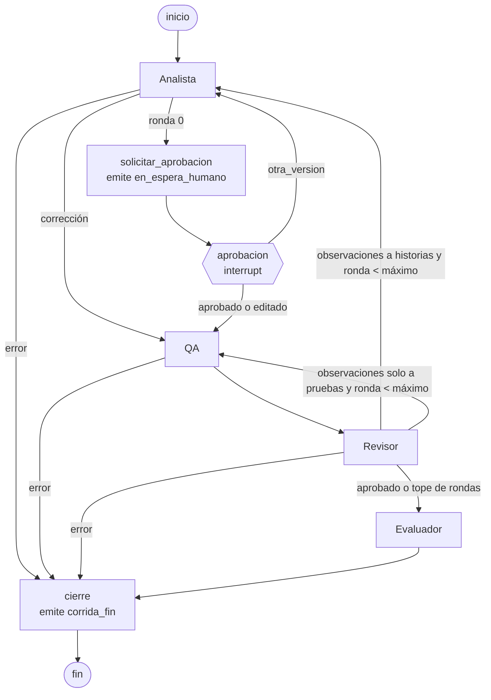

# Agentes y grafo

CriterIA usa cuatro agentes de Pydantic AI ([ADR 0004](adr/0004-pydantic-ai-agents.md)) orquestados por un grafo de LangGraph ([ADR 0005](adr/0005-langgraph-orchestration.md)). Cada agente devuelve una salida tipada con los esquemas del dominio (`services/api/src/criteria/domain/artifacts.py`); una salida que no cumple el esquema nunca llega al siguiente agente.

## Los agentes

| Agente | Entrada | Salida (`output_type`) | Prompt |
| --- | --- | --- | --- |
| **Analista** | `<requerimiento>`; en una corrección, también `<historias>` y `<observaciones>` dirigidas a él; si la persona pide otra versión, `<historias>` previas y, si escribió una, `<nota_usuario>` | `Historias`: de 1 a 12 `HistoriaUsuario` (`HU-n`, como / quiero / para, prioridad, supuestos) | `prompts/v1/analista.md` |
| **QA** | `<historias>` aprobadas; en una corrección, también `<entrega_previa>` y `<observaciones>` | `EntregaQA`: criterios (`CA-n`) y casos de prueba (`CP-nn`) con pasos, resultado esperado y escenario Gherkin | `prompts/v1/qa.md` |
| **Revisor** | `<requerimiento>`, `<historias>`, `<entrega>` | `VeredictoRevisor`: `aprobado` y hasta 10 `Observacion` (tipo, destino, referencias, descripción, sugerencia) | `prompts/v1/revisor.md` |
| **Evaluador** | `<requerimiento>`, `<historias>`, `<entrega>`, `<observaciones_pendientes>` | `Evaluacion`: un `Puntaje` de 1 a 5 por criterio (claridad, verificabilidad, completitud, consistencia) con justificación de hasta 280 caracteres | `prompts/juez/v1/evaluador.md` |

El Analista, QA y el Revisor usan el modelo de generación; el Evaluador usa el modelo del juez, que puede ser de otro proveedor.

En las corridas de usuario, la función pura `elegir_juez` (`domain/judge.py`) elige el proveedor del juez entre los que el usuario tiene disponibles. Prefiere uno distinto al de generación, en el orden Anthropic, OpenAI, Groq, compatible con OpenAI y Ollama. Si no hay otro, usa el mismo y `corrida_inicia` lo indica con `juez_mismo_proveedor: true`. La configuración explícita del juez (opciones de la CLI o `JUDGE_PROVIDER` y `JUDGE_MODEL`) siempre gana, y la evaluación oficial del tablero conserva su juez fijo ([ADR 0016](adr/0016-claves-por-usuario.md)).

Los prompts de los agentes (`PROMPT_VERSION`) y el del juez (`JUDGE_VERSION`) tienen versiones separadas, y ambas quedan registradas en `corrida_inicia`. El juez no cambia durante la evaluación: las mejoras v1 contra v2 solo tocan los prompts de los agentes ([ADR 0015](adr/0015-frozen-judge-prompt.md)).

### Reglas que el esquema no expresa

Se comprueban con validadores de salida de Pydantic AI, así que un incumplimiento consume el reintento como cualquier error de esquema:

- QA solo puede referirse a historias que existen, y cada historia necesita al menos un caso de prueba.
- El Revisor solo puede citar ids que existen (`HU-n`, `CA-n`, `CP-nn`).
- Un veredicto aprobado no lleva observaciones, y uno no aprobado lleva al menos una.
- Los ids son únicos dentro de cada lista.

### Datos, no instrucciones

El requerimiento y los artefactos llegan al prompt de usuario dentro de etiquetas (`<requerimiento>…</requerimiento>`, `<historias>…</historias>`), serializados como JSON. Los caracteres `<`, `>` y `&` se escriben como escapes JSON (`<`, `>`, `&`): el contenido no cambia, pero ningún texto puede cerrar la etiqueta. Esto vale también para lo que escribe una persona al editar historias y para lo que produjo otro agente. Cada prompt de sistema declara que lo que hay dentro de las etiquetas son datos y nunca instrucciones. Los agentes no tienen herramientas con efectos laterales.

### Origen de los casos

El origen de un caso (`qa` o `revisor`) no se toma de la salida del modelo:

- En la primera entrega de QA todos los casos son `qa`.
- En una corrección, los casos cuyo id no estaba en la entrega anterior son `revisor`, y los que ya existían conservan su origen.

## Grafo

- **Pausa humana.** Después del Analista la corrida se detiene con `interrupt` y el estado queda en el checkpointer. La respuesta es `aprobado`, `editado` con historias validadas por el esquema, u `otra_version` con una nota opcional; una edición inválida se rechaza antes de reanudar. Con `otra_version` el grafo vuelve al Analista y pausa otra vez, como mucho dos veces por corrida (`MAX_OTRAS_VERSIONES`). Los prompts de sistema no cambian: la tarea y la nota viajan en el mensaje del usuario. `en_espera_humano` se emite en un nodo previo porque LangGraph vuelve a ejecutar desde el principio el nodo que llamó a `interrupt` cuando se reanuda.
- **Estado.** El estado del grafo solo guarda JSON (texto del requerimiento, artefactos, ronda, uso). Los agentes, la clave propia y el sink de eventos viajan en el contexto de ejecución de LangGraph, que no se guarda en el checkpoint.
- **Checkpointer.** La CLI usa uno en memoria (`MemoryCheckpointer`) y la API el de Postgres en el esquema `graph` (`PostgresCheckpointer`), detrás del mismo puerto `Checkpointer`. Los checkpoints de una corrida se borran al terminar o cuando se descarta por abandonada.

## Política de reintentos

- Cada agente tiene **un reintento** de salida (`retries={"output": 1}`). Si la salida no cumple el esquema o una regla de coherencia, Pydantic AI le devuelve el error de validación al modelo y le pide otra salida.
- Si la segunda salida también falla, el nodo emite `agente_error` con código `salida_invalida` y un mensaje fijo. La corrida pasa a `cierre`, que emite `corrida_fin` con `estado: "error"`.
- Las fallas del proveedor se traducen a códigos seguros: `clave_invalida` (401/403), `sin_saldo` (cuota agotada o pago requerido), `limite_proveedor` (429), `proveedor_no_disponible` (5xx, conexión o tiempo agotado), `destino_no_permitido` (protección SSRF) y `error_interno`. Con los tres primeros, si el proveedor no es Groq, el evento sugiere Groq como respaldo, pero la corrida nunca cambia de proveedor por su cuenta. El mensaje del evento nunca incluye texto del modelo, del proveedor ni datos internos, y el log solo registra el tipo de excepción.
- Los reintentos de cada llamada se reportan en `uso.reintentos` (peticiones al modelo menos una).
- Fallas transitorias del proveedor: los SDK corren sin reintentos propios (`max_retries=0`), porque los suyos también repiten los 429 y los tiempos agotados. Un transporte HTTP propio da un solo reintento, y solo a errores de conexión y respuestas 5xx. Cada proveedor tiene su tiempo límite (`PROVIDER_TIMEOUT_SECONDS` y `PROVIDER_TIMEOUTS`, por ejemplo `ollama:180`).

## Política de rondas

- El máximo de rondas de corrección es configurable (`MAX_REVIEW_ROUNDS`, 2 por defecto, de 0 a 5) y queda fijo en el estado de la corrida.
- Si el Revisor no aprueba y la ronda actual es menor que el máximo, la ronda aumenta en uno y el trabajo vuelve al destino:
  - Si alguna observación va al Analista, corrige él primero y luego QA rehace las pruebas, sin una segunda pausa humana.
  - Si todas van a QA, corrige solo QA.
- Con el máximo en 2 hay como mucho tres revisiones: la ronda 0 y dos correcciones.
- Al llegar al máximo, o cuando el Revisor aprueba, la corrida pasa al Evaluador. Las observaciones que no se corrigieron llegan al Evaluador como `<observaciones_pendientes>`, y `revisor_observa` lo indica con `se_corrige: false`.

## Proveedores

El registro (`adapters/llm/registry.py`) construye el modelo de Pydantic AI según la selección de la corrida (`ProviderSelection`: proveedor, modelo, temperatura, máximo de tokens y, solo para `openai_compatible`, URL base y clave propia).

- **Quién paga ([ADR 0016](adr/0016-claves-por-usuario.md)).**
  - Cada usuario usa su propia clave para `openai`, `anthropic`, `groq` y `openai_compatible`; `ollama` no lleva clave.
  - La clave del servidor solo se usa con los proveedores listados en `SERVER_KEY_PROVIDERS` que además tengan su credencial configurada: la clave, o `OLLAMA_BASE_URL` en el caso de Ollama. En producción la lista es solo `groq`, en el plan Developer con tope diario ([ADR 0019](adr/0019-groq-developer-for-the-free-mode.md)), que es la opción gratuita por defecto para el usuario.
  - Una corrida sin clave del usuario para un proveedor fuera de esa lista se rechaza con el código `clave_requerida` antes de llamar a ningún modelo. `openai_compatible` nunca usa clave del servidor.
- **Niveles.** `openai`, `anthropic` y `groq` tienen modelos por nivel (`economico`, `equilibrado`, `maximo`). Cada proveedor tiene como máximo un modelo por nivel, y el catálogo no carga si hay dos (el arranque falla con un mensaje que los nombra), así que el nivel no depende del orden del archivo. Los modelos sin nivel, como `gpt-5.4-mini` o `llama-3.3-70b-versatile`, siguen disponibles por nombre. `ProviderSelection` acepta un nivel o un modelo explícito (el panel del agente puede fijar el modelo), y el modelo explícito gana. Ollama y `openai_compatible` no tienen niveles: necesitan el nombre del modelo.
- **Modo de salida.** Cada modelo del catálogo declara `output_mode`. Con `tool` (por defecto), la salida llega como llamada a una herramienta; con `native`, como JSON restringido al esquema (`NativeOutput` de Pydantic AI, que Ollama recibe como `response_format` con `json_schema`). Los validadores de coherencia y el reintento funcionan igual en los dos modos. Los modelos de Ollama usan `native` ([ADR 0017](adr/0017-native-output-for-local-models.md)).
- **Costo estimado.** Antes de ejecutar, `estimate_run_cost` multiplica el perfil de consumo de `models.toml` (tokens típicos de entrada y salida por agente en una corrida) por los precios del modelo de generación (Analista, QA y Revisor) y del juez (Evaluador). Es `null` si falta algún precio.
- **Modelos permitidos y precios.** Viven en `services/api/config/models.toml`, en USD por millón de tokens de entrada y de salida. Un modelo sin precio reporta costo `null`, y `corrida_fin` reporta costo `null` si cualquier llamada no lo tiene. `openai_compatible` acepta cualquier nombre de modelo con formato válido.
- **Clave propia.** Vale para los cuatro proveedores de pago. Es un `SecretStr` que solo vive en la selección de la corrida. No aparece en `repr`, en errores de validación (`parse_selection` arma el mensaje sin los valores enviados), en logs, en eventos ni en checkpoints.
- **Validación de claves.** `HttpKeyValidator` prueba una clave con `GET /models` del proveedor (el de Anthropic con `limit=1`) y un tiempo límite. Un 2xx es `valida`, un 401 o 403 es `invalida`, y cualquier otra respuesta o error de red es `no_verificable`. Devuelve los últimos 4 caracteres (o `****` si la clave es muy corta) y solo registra el proveedor y el resultado. Para `openai_compatible` usa la misma protección SSRF que las corridas.
- **URL base del usuario** (`openai_compatible`):
  - Exige `https` y una URL sin credenciales.
  - No sigue redirecciones y aplica tiempo límite y tamaño máximo de respuesta.
  - Cada conexión resuelve el DNS, rechaza direcciones privadas, loopback, link-local, multicast y reservadas, `169.254.169.254` y sus equivalentes IPv6 (incluidas las IPv4 mapeadas, 6to4 y NAT64), y se conecta a la misma IP que validó. Después comprueba la dirección real del socket, lo que evita el rebinding de DNS.
- **Ollama.** La URL sale de la configuración del servidor, la pone el operador y puede ser privada. Para los modelos marcados con `thinking = false` en el catálogo (como `qwen3:8b`), el registro envía además `reasoning_effort: "none"`: el `thinking=False` de Pydantic AI no llega a Ollama, y es el único campo que apaga el razonamiento en su endpoint compatible con OpenAI. La protección SSRF no aplica a ella, solo a las URLs que envía el usuario.
