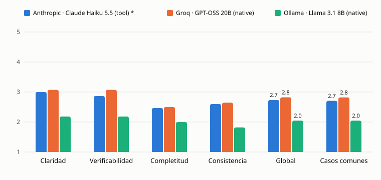

# Evaluación

Comparación de tres modelos sobre el mismo conjunto de requerimientos, con el mismo grafo y el mismo juez, más la validación del juez contra una calificación humana. Los números de la versión 1 están en [Resultados v1](#resultados-v1) y el reporte autocontenido en [evaluation/report-v1.md](evaluation/report-v1.md).

## Objetivo

Comparar modelos (API y local) y versiones de prompts con métricas reproducibles sobre el mismo conjunto de casos y el mismo juez, y saber cuánto se puede confiar en ese juez.

## Conjunto de casos

15 requerimientos en español escritos para la evaluación, en `services/api/eval/cases/*.toml`, sin datos reales de personas ni de instituciones y de 365 a 825 caracteres:

- 5 fáciles y 5 medios, de dominios variados: educación, comercio, salud administrativa, logística, finanzas, trámites de gobierno, recursos humanos y seguros.
- 5 difíciles con 5 problemas sembrados cada uno (25 en total): ambigüedades, inconsistencias y faltantes, del mismo tipo que las observaciones del Revisor. Los problemas viven en los metadatos del caso y nunca llegan a los agentes.

| Id         | Título                                           | Dominio                        |
| ---------- | ------------------------------------------------ | ------------------------------ |
| facil-01   | Asistencia a talleres extracurriculares          | educación                      |
| facil-02   | Lista de deseos de una tienda en línea           | comercio                       |
| facil-03   | Recordatorios de citas de una clínica dental     | salud administrativa           |
| facil-04   | Rastreo de envíos por número de guía             | logística                      |
| facil-05   | Registro de gastos personales                    | finanzas                       |
| medio-01   | Licencia de funcionamiento para comercios        | trámites de gobierno           |
| medio-02   | Inscripción a materias con cupo y prerrequisitos | educación                      |
| medio-03   | Solicitudes de vacaciones con aprobación         | recursos humanos               |
| medio-04   | Pedidos para recoger en una cadena de cafeterías | comercio                       |
| medio-05   | Reembolso de gastos médicos                      | seguros y salud administrativa |
| dificil-01 | Rutas de reparto de una distribuidora            | logística                      |
| dificil-02 | Apoyo económico a pequeños productores           | trámites de gobierno           |
| dificil-03 | Préstamos de una caja de ahorro                  | finanzas                       |
| dificil-04 | Entrega y calificación de tareas                 | educación                      |
| dificil-05 | Programación de quirófanos de un hospital        | salud administrativa           |

## Método

- **Corridas.** `criteria eval run` corre el grafo completo de la app (Analista, pausa humana, QA, Revisor con hasta 2 rondas de corrección y Evaluador) con prompts v1 y juez v1, una corrida por caso y de forma secuencial.
- **Aprobación humana automática.** La pausa se responde aprobando las historias sin cambios, así que cada modelo trabaja con las historias de su propio Analista. Es parte del método: no hay una persona editando entre etapas.
- **Parámetros iguales para todos.** Temperatura pedida de 0.2 para los agentes y tope de 16,384 tokens por llamada (8,192 en Ollama; ver [Modelos comparados](#modelos-comparados)). Cada modelo usa el modo de salida de su entrada del catálogo (`tool` o `native`), que se muestra junto a su nombre en las tablas y en el tablero.
- **Parámetros que el proveedor ignora.** `claude-haiku-5-5` no acepta `temperature`. El juez y el emparejador (los dos con Haiku) corren con el muestreo predeterminado del modelo, igual que la generación del lote de Haiku. Cada lote guarda en `parametros_ignorados` lo que el proveedor descartó, y la [estabilidad](#estabilidad-del-juez-y-del-emparejador) mide qué tanto varía el juez por eso.
- **Errores.** Un error del modelo (salida inválida tras el reintento, tiempo agotado) es un resultado del lote. Un 429 espera 30, 60 y 120 s y repite el caso completo. Un error de cuenta (`clave_invalida`, `sin_saldo`, `cupo_gratuito_agotado`) o un 429 persistente detienen el lote sin registrar el caso, que se repite al reanudar.
- **Costo real.** Suma todo lo que se cobró, incluidas las llamadas que fallaron y los intentos repetidos tras un 429. El emparejador se cuenta aparte, como costo de análisis.
- **Registro y reproducibilidad.** Cada lote es un JSON versionado en `services/api/eval/results/v1/<proveedor>-<modelo>.json`, con proveedor, modelo, `display_name`, modo de salida, versiones de prompts y del juez, `git_sha`, temperatura, tope de tokens, fecha y, en Ollama, versión, contexto, flash attention, tipo de caché y porcentaje en GPU. Por caso guarda artefactos, salidas válidas a la primera por agente, reintentos, errores, rondas, latencia por agente y total, tokens, costo y puntajes del juez con su justificación. El lote se guarda después de cada caso y se reanuda con el mismo comando.

## Rúbrica

Puntaje de 1 a 5 por criterio, con una justificación breve:

- `claridad`: los artefactos se entienden sin ambigüedad.
- `verificabilidad`: los criterios y los casos se pueden comprobar con un resultado observable.
- `completitud`: el requerimiento queda cubierto por historias y cada historia por pruebas.
- `consistencia`: historias, criterios y casos concuerdan entre sí y con el requerimiento.

Escala: 1 deficiente, 2 con problemas graves, 3 aceptable con problemas, 4 bueno con detalles menores, 5 sin problemas relevantes. El puntaje global de una corrida es el promedio de sus cuatro criterios.

## Juez y su validación

El juez no cambia durante la evaluación. Su prompt vive en `services/api/prompts/juez/vN/evaluador.md` con una versión propia (`JUDGE_VERSION`), y cada corrida registra `version_prompts` y `version_juez` ([ADR 0015](adr/0015-frozen-judge-prompt.md)). Las mejoras v1 contra v2 solo tocan los prompts de los agentes, así que una diferencia de puntaje no puede venir de un juez distinto.

- **Juez.** `claude-haiku-5-5` con el juez v1 para los tres lotes, deliberadamente severo: un 5 es excepcional y, si duda entre dos valores, elige el menor. El lote de Haiku se marca con `*` porque el juez es de su mismo proveedor.
- **Calificación humana.** `criteria eval score` toma una muestra estratificada con semilla fija: 8 corridas repartidas lo más parejo posible entre los modelos (con tres modelos, 3, 3 y 2; la semilla decide cuál lleva 2), de dificultades distintas dentro de cada modelo; los 4 criterios de cada una, 32 pares. Es a ciegas: no muestra el modelo ni el puntaje del juez, y presenta los mismos artefactos y la misma rúbrica que recibió el juez.
- **Acuerdo.** Kappa de Cohen ponderada cuadrática, correlación de Spearman, acuerdo exacto y a ±1 punto, en total y por criterio, con intervalos al 95 % por bootstrap (2,000 remuestreos de los pares, semilla fija). La diferencia media juez menos humano dice si el juez califica más alto o más bajo.

### Estabilidad del juez y del emparejador

Como el juez no acepta temperatura, `criteria eval stability` le vuelve a pedir la calificación de 10 corridas elegidas con semilla fija, alternando modelos, y reporta su acuerdo consigo mismo: kappa ponderada y acuerdo exacto sobre los 40 pares. Lo mismo con el emparejador en los 5 casos difíciles de un lote elegido con la semilla (25 decisiones).

## Detección de problemas sembrados

En los 5 casos difíciles, un emparejador automático decide para cada problema sembrado si alguna observación del Revisor, en cualquier ronda, lo detectó y con cuál.

- **Emparejador.** `claude-haiku-5-5` con un prompt propio, versionado y congelado en `services/api/prompts/analisis/v1/emparejador.md`. Su salida es tipada: problema, detectado (sí o no), número de la observación que lo detecta y una justificación breve. Si duda, el problema no cuenta como detectado.
- **Fuera de la corrida.** No participa en las corridas ni en la rúbrica: es análisis posterior sobre los lotes ya guardados (`criteria eval match`). Solo se emparejan las corridas difíciles completas.
- **Validación.** En la misma sesión humana se revisan 10 emparejamientos elegidos con semilla fija, a ciegas sobre el modelo, y se reporta qué proporción confirmó la persona.
- **Métrica.** Tasa de detección por modelo, en total y por tipo, siempre con su denominador, y la lista de problemas que ningún modelo detectó entre los que completaron cada caso. Un modelo que no completó los 5 casos difíciles tiene una tasa sobre menos casos: se marca como no directamente comparable, y una columna aparte compara a todos sobre los casos difíciles que todos completaron.

## Comparación sobre los casos comunes

Un modelo con corridas fallidas promedia sobre menos casos, y no siempre los mismos. Por eso, además del promedio general (todas sus corridas completas), el reporte y el tablero dan el puntaje de cada modelo sobre los casos que todos los modelos de la misma versión completaron y el juez calificó. El tablero destaca el mejor puntaje sobre esos casos comunes.

## Modelos comparados

| Modelo                                            | Modo de salida | Tope de tokens | Nota                                                             |
| ------------------------------------------------- | -------------- | -------------- | ---------------------------------------------------------------- |
| Anthropic · Claude Haiku 5.5 (`claude-haiku-5-5`) | `tool`         | 16,384         | El juez es del mismo proveedor (`*`)                             |
| Groq · GPT-OSS 20B (`openai/gpt-oss-20b`)         | `native`       | 16,384         | Modelo del modo gratuito en producción                           |
| Ollama · Llama 3.1 8B (`llama3.1:8b`)             | `native`       | 8,192          | Local, RTX 4060; ver [la selección](#selección-del-modelo-local) |

**Cambio de alcance.** El plan incluía OpenAI `gpt-6-luna`, pero su lote se detuvo en el primer caso con `sin_saldo`: el crédito de la cuenta venció. La evaluación v1 queda con tres modelos. OpenAI se probará en producción con la clave de cada usuario, y el catálogo conserva sus modelos.

**Tope de tokens por modelo.** Los modelos por API usan 16,384, el valor por defecto de la app. Ollama usa 8,192 (`max_tokens` en su entrada de `models.toml`) porque su contexto es de 16,384 y una petición grande (6,652 tokens medidos) más 16,384 de salida no caben. Es la única diferencia de configuración entre lotes, y queda registrada en cada uno.

**Tiempo límite.** Cada proveedor usa el tiempo límite de la app: 60 s por llamada para los modelos por API y 180 s para Ollama (`PROVIDER_TIMEOUTS=ollama:180`).

**Reanudaciones.** El lote de Ollama se detuvo en el segundo caso porque la cuenta de Anthropic del juez se quedó sin saldo; el caso no se registró y el lote se reanudó tras la recarga. Al reanudar, el código había avanzado de `f5e5b9a` a `ec270c4`, un commit que solo cambió la muestra de la calificación humana y la documentación, no el camino de una corrida. El lote conserva el SHA con el que empezó.

## Hallazgos de integración antes de los lotes v1

Ninguno cambió los prompts; todos cambiaron cómo se llama al modelo, y los lotes afectados se repitieron completos.

- **gpt-oss-20b con salida por herramienta.** En el primer intento, 0 de 7 corridas completas y 0 de 8 llamadas válidas a la primera. En el reintento, el modelo producía la salida correcta pero llamaba a la herramienta `functions.final_result` en lugar de `final_result`, y Pydantic AI la descartaba como herramienta desconocida; otras veces Groq rechazaba la llamada mal formada con un 400. Con salida JSON nativa, 3 de 3 salidas fueron válidas a la primera ([ADR 0021](adr/0021-native-output-for-gpt-oss-on-groq.md)).
- **Rechazos del esquema en Groq.** Con salida nativa, Groq valida el JSON en su servidor y rechaza con un 400 (`json_validate_failed`) la salida que no cumple. Ahora cuenta como salida inválida y tiene el mismo reintento único que los demás modelos.
- **Tope de 4,096 y de 8,192 tokens.** Los tokens de razonamiento de gpt-oss cuentan dentro del tope. Con 4,096, el Revisor salió bien 1 de 4 veces; con 8,192, Groq siguió rechazando salidas vacías. Al repetir la misma petición sin esquema, 3 de 6 respuestas terminaron con `finish_reason=length`, 8,190 tokens de razonamiento y contenido vacío: los rechazos eran por longitud. Con 16,384 bajaron de 4 de 6 a 1 de 6, y esa también fue por longitud (16,382 tokens de razonamiento). En Haiku, el primer lote con 8,192 completó 7 de 15 corridas: sus entregas de QA en las rondas de corrección promediaban de 7,400 a 8,100 tokens por petición y el JSON se cortaba.
- **Tiempo límite de Ollama más corto que su tope de tokens.** En el lote v1, 4 de 15 corridas de `llama3.1:8b` terminaron con `proveedor_no_disponible` por tiempo agotado: 3 en QA y 1 en el Analista. En las corridas completas el modelo generó a unos 40 tokens por segundo (16,706 tokens de QA en 414 s), así que una llamada de más de unos 7,000 tokens no cabe en 180 s aunque el tope sea 8,192. El fallo del Analista sugiere un bucle de repetición: suele responder en unos 20 s con unos 500 tokens. Una llamada cortada por tiempo no devuelve uso, así que no se sabe cuántos tokens llevaba ni si habría terminado bien. Se aceptaron las 11 corridas completas como resultado v1, porque el método trata un tiempo agotado como un resultado y 180 s es la configuración de la app; alinear el tiempo límite con el tope queda como mejora candidata para v2.
- **Costo de las llamadas fallidas.** Antes no se sumaba (el evento de error no llevaba uso), así que el costo de un lote con errores salía en cero. Ahora cuenta en los totales, en la reserva del tope global y en los lotes. Los rechazos de Groq no devuelven uso, así que su costo no se puede medir; el de un lote de Groq es un mínimo.

## Selección del modelo local

Prueba de selección hecha en F2b (5 nov 2026). No es la evaluación formal: son tres requerimientos de ejemplo por modelo, sin repeticiones, así que sirve para descartar configuraciones que no funcionan, no para medir diferencias finas de calidad.

### Método

- **Candidatos:** `qwen3:8b` (con el razonamiento apagado) y `llama3.1:8b`, ambos en Q4_K_M.
- **Casos:** los tres ejemplos de `services/api/examples/` (biblioteca, citas médicas y nómina), con `criteria run --auto-aprobar --json`, dos rondas de corrección como máximo, temperatura 0.2 y juez Claude Haiku (`claude-haiku-5-5`) con el juez v1.
- **Precarga:** antes de la primera corrida de cada modelo se hizo una llamada corta para que la carga no contara en la latencia, y se comprobó con `/api/ps` que el modelo estuviera al 100 % en la GPU.
- **Registro de validaciones:** las corridas se hicieron en proceso con un envoltorio del modelo que registra el motivo de cada reintento y los tokens reales de cada petición (`prompt_eval_count`).
- **Dos series:** primero con salida por herramienta (la predeterminada de Pydantic AI) y después con salida JSON nativa restringida al esquema ([ADR 0017](adr/0017-native-output-for-local-models.md)).

### Configuración de Ollama

Afecta la latencia, así que forma parte del resultado:

| Parámetro                  | Valor                                                                  |
| -------------------------- | ---------------------------------------------------------------------- |
| Equipo                     | PC con NVIDIA RTX 4060 (8 GB de VRAM), en la red local                 |
| Ollama                     | 0.40.14                                                                |
| `OLLAMA_CONTEXT_LENGTH`    | 16384                                                                  |
| `OLLAMA_FLASH_ATTENTION`   | 1                                                                      |
| `OLLAMA_KV_CACHE_TYPE`     | `q8_0`                                                                 |
| Carga en GPU               | 100 % para los dos modelos (`qwen3:8b` 6.28 GB, `llama3.1:8b` 5.90 GB) |
| Razonamiento de `qwen3:8b` | apagado con `reasoning_effort: "none"`                                 |

Con 16,384 tokens de contexto y la caché en `f16`, `qwen3:8b` solo cabía al 80 % en la GPU. Flash attention y la caché en `q8_0` lo dejaron al 100 % sin reducir el contexto. Un contexto de 8,192 tokens se descartó porque una ronda de corrección de QA puede acercarse a ese tamaño. La petición más grande medida fue de 6,652 tokens (40.6 % del contexto).

### Resultados

| Modo de salida | Modelo        | Corridas completas | Salidas válidas a la primera | Latencia media (corridas completas) | Puntaje medio |
| -------------- | ------------- | ------------------ | ---------------------------- | ----------------------------------- | ------------- |
| nativa         | `llama3.1:8b` | 3 de 3             | 25 de 26 (96 %)              | 170 s                               | 2.17          |
| nativa         | `qwen3:8b`    | 2 de 3             | 24 de 25 (96 %)              | 233 s                               | 2.25          |
| herramienta    | `qwen3:8b`    | 1 de 3             | 4 de 7 (57 %)                | 70 s                                | 2.50          |
| herramienta    | `llama3.1:8b` | 0 de 3             | 3 de 7 (43 %)                | —                                   | —             |

Las salidas válidas a la primera cuentan las llamadas a Analista, QA y Revisor (el juez no es local). La latencia de las corridas completas no es comparable entre modos: con salida por herramienta, la única corrida completa no tuvo rondas de corrección. El puntaje medio es el promedio de los cuatro criterios del juez en las corridas completas, de 1 a 5, con un juez que pide severidad.

La única corrida fallida con salida nativa (`qwen3:8b`, biblioteca) no fue de validación. El QA de la segunda corrección agotó el tiempo: tres intentos de 60 s (`PROVIDER_TIMEOUT_SECONDS` más los dos reintentos internos del SDK de OpenAI), 181 s en total, y terminó con `proveedor_no_disponible`.

### Decisión

El modelo local de la evaluación es **`llama3.1:8b`** con salida nativa: completó las tres corridas, con el 96 % de salidas válidas a la primera, y fue el más rápido (170 s de media contra 233 s). En calidad, los dos modelos quedaron parejos: 2.17 contra 2.25, una diferencia que tres corridas no permiten distinguir. `qwen3:8b` se queda en el catálogo.

## Cómo reproducir

Desde `services/api`, con las claves en el `.env` local y los proveedores en `SERVER_KEY_PROVIDERS`:

```bash
uv run criteria eval run --provider anthropic --model claude-haiku-5-5
uv run criteria eval run --provider groq --model openai/gpt-oss-20b
uv run criteria eval run --provider ollama --model llama3.1:8b \
  --ollama-context 16384 --ollama-flash-attention 1 --ollama-kv-cache q8_0
uv run criteria eval match        # emparejador de problemas sembrados
uv run criteria eval stability    # el juez y el emparejador contra sí mismos
uv run criteria eval score        # calificación humana a ciegas, pausable con p
uv run criteria eval report       # tablas.md, reporte.json y la gráfica
uv run criteria eval publish --file eval/results/v1/<lote>.json   # rol eval_writer
uv run criteria eval publish --human
```

Todos los comandos se reanudan donde se quedaron. `publish` es idempotente: los ids de las filas se derivan del lote y del caso.

## Resultados v1

Lotes del 10 y 11 de noviembre de 2026, prompts v1 y juez v1. Los archivos de cada lote, la sesión humana y la estabilidad están en `services/api/eval/results/v1/`; `tablas.md` y `reporte.json` son la salida de `criteria eval report`. `*` marca el lote cuyo juez es del mismo proveedor.

**Métricas principales y secundarias.** Las métricas principales de v1 son las que no dependen del juez: detección de problemas sembrados, robustez, latencia y costo. Los puntajes del juez son secundarios. El juez es consistente pero no está validado: las diferencias de puntaje se leen con cautela, y la de Haiku contra GPT-OSS es menor que la variación del juez ([Acuerdo del juez](#acuerdo-del-juez-con-la-calificación-humana)).

### Detección de problemas sembrados

| Modelo                                | Casos emparejados | Total          | Ambigüedad   | Inconsistencia | Faltante      | En los 3 difíciles comunes |
| ------------------------------------- | ----------------- | -------------- | ------------ | -------------- | ------------- | -------------------------- |
| Anthropic · Claude Haiku 5.5 (tool) * | 5 de 5            | 52% (13 de 25) | 71% (5 de 7) | 67% (4 de 6)   | 33% (4 de 12) | 60% (9 de 15)              |
| Groq · GPT-OSS 20B (native)           | 5 de 5            | 32% (8 de 25)  | 14% (1 de 7) | 67% (4 de 6)   | 25% (3 de 12) | 27% (4 de 15)              |
| Ollama · Llama 3.1 8B (native)        | 3 de 5 †          | 7% (1 de 15)   | 20% (1 de 5) | 0% (0 de 3)    | 0% (0 de 7)   | 7% (1 de 15)               |

† No directamente comparable: Llama no completó `dificil-02` ni `dificil-05`, y el emparejador solo lee corridas completas. La última columna compara a los tres sobre `dificil-01`, `dificil-03` y `dificil-04`.

El emparejador se validó con la revisión humana (10 de 10 decisiones confirmadas) y es estable consigo mismo (96 %); ver [abajo](#acuerdo-del-emparejador-con-la-revisión-humana).

Ningún modelo detectó 9 de los 25 problemas, y 7 de ellos son faltantes. Por ejemplo: qué pasa con una entrega fallida en `dificil-01`, o cómo se resuelven dos solicitudes para el mismo quirófano en `dificil-05`. La lista completa está en `tablas.md`. Los faltantes son el tipo más difícil para los tres modelos: el Revisor señala lo que está escrito mal más que lo que no está escrito.

### Robustez, latencia y costo

| Modelo                                | Completas | Válidas a la primera | Rondas medias | Latencia p50 | Latencia p95 | Tokens por corrida | Costo por corrida (USD) | Costo del lote (USD) | Errores                      |
| ------------------------------------- | --------- | -------------------- | ------------- | ------------ | ------------ | ------------------ | ----------------------- | -------------------- | ---------------------------- |
| Anthropic · Claude Haiku 5.5 (tool) * | 15 de 15  | 97% (145 de 149)     | 2.0           | 148 s        | 207 s        | 127,841            | 0.0296                  | 0.4442               | ninguno                      |
| Groq · GPT-OSS 20B (native)           | 14 de 15  | 96% (102 de 106)     | 1.6           | 33 s         | 61 s         | 47,129             | 0.0089                  | 0.1264               | `salida_invalida`: 1         |
| Ollama · Llama 3.1 8B (native)        | 11 de 15  | 90% (111 de 123)     | 2.0           | 329 s        | 476 s        | 54,328             | 0.0015                  | 0.0160               | `proveedor_no_disponible`: 4 |

**Cómo leer la tabla**

- **Válidas a la primera** cuenta cada llamada a un agente.
- **Latencia, tokens y costo por corrida** son de las corridas completas.
- **Costo:** incluye el juez; en el lote local es solo el juez. El de Groq es un mínimo, porque sus rechazos no devuelven uso.
- **Tope de tokens:** 16,384 para Haiku y GPT-OSS y 8,192 para Llama ([Modelos comparados](#modelos-comparados)).
- **Fallos de Llama:** sus 4 corridas fallidas son tiempos agotados ([hallazgos](#hallazgos-de-integración-antes-de-los-lotes-v1)).

### Puntajes del juez (secundarios)

| Modelo                                | Global (todas) | Global (11 comunes) | Claridad | Verificabilidad | Completitud | Consistencia |
| ------------------------------------- | -------------- | ------------------- | -------- | --------------- | ----------- | ------------ |
| Anthropic · Claude Haiku 5.5 (tool) * | 2.73           | 2.70                | 3.00     | 2.87            | 2.47        | 2.60         |
| Groq · GPT-OSS 20B (native)           | 2.82           | 2.82                | 3.07     | 3.07            | 2.50        | 2.64         |
| Ollama · Llama 3.1 8B (native)        | 2.05           | 2.05                | 2.18     | 2.18            | 2.00        | 1.82         |

**Cómo leer la tabla**

- **Escala:** los puntajes van de 1 a 5, con un juez que pide severidad, y su escala absoluta no coincide con la de una persona.
- **Criterios:** son los promedios de todas las corridas completas.
- **Casos comunes:** son los 11 que los tres modelos completaron: `dificil-01`, `dificil-03`, `dificil-04`, `facil-02` a `facil-05`, `medio-01`, `medio-02`, `medio-04` y `medio-05`.
- **Criterios en los casos comunes:**
  - Haiku: 3.00, 2.82, 2.45 y 2.55.
  - GPT-OSS: 3.09, 3.09, 2.45 y 2.64.
  - Llama: no cambian.



| Modelo                                | Fáciles       | Medios        | Difíciles     |
| ------------------------------------- | ------------- | ------------- | ------------- |
| Anthropic · Claude Haiku 5.5 (tool) * | 5 de 5 · 3.00 | 5 de 5 · 2.70 | 5 de 5 · 2.50 |
| Groq · GPT-OSS 20B (native)           | 5 de 5 · 2.90 | 4 de 5 · 2.94 | 5 de 5 · 2.65 |
| Ollama · Llama 3.1 8B (native)        | 4 de 5 · 2.19 | 4 de 5 · 1.94 | 3 de 5 · 2.00 |

Cada celda da las corridas completas y su puntaje global según el juez.

### Acuerdo del juez con la calificación humana

| Criterio        | Pares | Kappa ponderada     | Spearman             | Exacto        | ±1              | Juez menos humano    |
| --------------- | ----- | ------------------- | -------------------- | ------------- | --------------- | -------------------- |
| Todos           | 32    | -0.02 [-0.08, 0.05] | -0.12 [-0.46, 0.22]  | 9% [0%, 22%]  | 38% [22%, 53%]  | -1.78 [-2.09, -1.47] |
| Claridad        | 8     | 0.03 [-0.02, 0.08]  | 0.27 [-0.15, 0.77]   | 12% [0%, 38%] | 38% [12%, 75%]  | -1.50 [-1.88, -1.00] |
| Verificabilidad | 8     | -0.17 [-0.31, 0.00] | -0.58 [-1.00, -0.14] | 25% [0%, 50%] | 75% [38%, 100%] | -1.12 [-1.75, -0.50] |
| Completitud     | 8     | 0.01 [0.00, 0.06]   | 0.29 [0.14, 0.75]    | 0% [0%, 0%]   | 0% [0%, 0%]     | -2.50 [-2.88, -2.12] |
| Consistencia    | 8     | 0.05 [-0.04, 0.25]  | 0.18 [-0.58, 0.74]   | 0% [0%, 0%]   | 38% [0%, 75%]   | -2.00 [-2.62, -1.38] |

La muestra tiene 8 corridas (3 de Haiku, 3 de GPT-OSS y 2 de Llama), con 4 criterios cada una. Las calificó a ciegas una persona, que es el autor del proyecto. Los intervalos son al 95 % por bootstrap.

Distribución de los 32 puntajes:

| Quién   | 1   | 2   | 3   | 4   | 5   | Media |
| ------- | --- | --- | --- | --- | --- | ----- |
| Juez    | 0   | 14  | 15  | 3   | 0   | 2.66  |
| Persona | 0   | 0   | 2   | 14  | 16  | 4.44  |

**Observación del evaluador.** Las 8 corridas le parecieron de buena calidad y le costó distinguirlas, así que sus puntajes probablemente se concentran en 4 y 5.

**Lectura de las métricas**

La distribución confirma la observación: 30 de los 32 puntajes humanos son 4 o 5, y la mitad son 5. Hay efecto techo. Pero la falta de acuerdo no se explica solo por el techo, porque el juez usa la otra mitad de la escala: 29 de sus 32 puntajes son 2 o 3, y ninguno es 5. Son dos rangos estrechos que casi no se tocan, separados por 1.78 puntos en promedio.

- **Kappa y Spearman.** La kappa ponderada mide el acuerdo más allá del que darían las dos distribuciones por azar. Hay muy poca variación dentro de cada calificador: la persona casi solo usa 4 y 5, y el juez, 2 y 3. Con tan poca señal que ordenar, estas dos métricas no pueden salir altas aunque los dos coincidieran en qué corrida es mejor. Aun así, a nivel de corrida no hay acuerdo: Spearman de −0.12, con un intervalo de −0.46 a 0.22.
- **Acuerdo exacto y a ±1.** Estas métricas no dependen de la variación, pero sí del nivel. El juez coincide en el valor exacto en 3 de 32 pares (9 %) y queda a un punto o menos en 12 (38 %). La diferencia es sistemática: el juez califica 1.78 puntos más bajo en promedio, y 2.5 en completitud.
- **Causas probables del desfase.** Hay dos. La primera es la instrucción de calibración del juez v1: «un 5 es excepcional; si dudas entre dos valores, elige el menor». La segunda es una escala sin anclas por nivel, que deja a cada calificador su propio punto de referencia. La rúbrica debe ser la misma para todos los modelos: la mejora es agregar anclas por nivel, no ajustar la severidad por modelo.
- **Qué se puede afirmar.** El juez es consistente: recalificar 10 corridas da una kappa de 0.74. Pero consistencia no es validez, y contra una persona no hay acuerdo a nivel de corrida. Su escala absoluta no está calibrada (un 2.7 del juez no significa «regular»), y las diferencias de puntaje entre modelos se leen con cautela.

**Por modelo en la muestra (descriptivo, no concluyente)**

| Modelo                                | Corridas | Juez | Persona |
| ------------------------------------- | -------- | ---- | ------- |
| Anthropic · Claude Haiku 5.5 (tool) * | 3        | 2.83 | 4.58    |
| Groq · GPT-OSS 20B (native)           | 3        | 2.75 | 4.25    |
| Ollama · Llama 3.1 8B (native)        | 2        | 2.25 | 4.50    |

- **El orden no coincide del todo.** Los dos ponen primero a Haiku. Pero el juez pone a Llama al final, y la persona lo pone segundo, por delante de GPT-OSS.
- **Las diferencias de la persona son pequeñas** (de 0.08 a 0.33 puntos) y salen de 2 o 3 corridas por modelo. No permiten ordenar los modelos.
- **Impresión del evaluador frente a sus puntajes.** Como evaluador, percibió al modelo local como el menos claro. Sus puntajes de la muestra a ciegas no lo reflejan: a las 2 corridas de Llama les dio 4.5 en claridad, y a las de Haiku y GPT-OSS, 4.33. Se registra como impresión cualitativa, sin peso en los resultados.

### Acuerdo del emparejador con la revisión humana

La persona confirmó las 10 decisiones revisadas (10 de 10). El bootstrap da [100 %, 100 %] porque no hay variación que remuestrear. El intervalo exacto de Clopper-Pearson al 95 % va de 69 % a 100 %.

### Estabilidad

| Quién                                             | Pares | Kappa             | Acuerdo exacto  |
| ------------------------------------------------- | ----- | ----------------- | --------------- |
| Juez (puntaje por criterio, ponderada cuadrática) | 40    | 0.74 [0.59, 0.85] | 72% [57%, 85%]  |
| Emparejador (detectado o no)                      | 25    | 0.91 [0.69, 1.00] | 96% [88%, 100%] |

Al volver a calificar las mismas 10 corridas, el juez cambia 11 de 40 puntajes individuales, siempre por un punto. El emparejador cambió 1 de 25 decisiones.

### Costo real

| Concepto                                                                                              | USD        |
| ----------------------------------------------------------------------------------------------------- | ---------- |
| Lote de Haiku (generación y juez)                                                                     | 0.4442     |
| Lote de GPT-OSS 20B (generación y juez)                                                               | 0.1264     |
| Lote de Llama 3.1 8B (solo juez)                                                                      | 0.0160     |
| Emparejador (los tres lotes)                                                                          | 0.0146     |
| Estabilidad del juez y del emparejador                                                                | 0.0196     |
| **Resultados v1**                                                                                     | **0.6208** |
| Lotes descartados por los [hallazgos de integración](#hallazgos-de-integración-antes-de-los-lotes-v1) | 0.5782     |
| Diagnósticos (reproducir los rechazos de Groq), estimado                                              | ~0.04      |
| **Total de la fase**                                                                                  | **~1.24**  |

Los lotes descartados se guardaron fuera del repositorio. El de salida por herramienta de Groq y el de OpenAI registran 0 porque terminaron antes de que se contara el costo de las llamadas fallidas.

### Conclusiones

Primero, las métricas principales:

- **Haiku detecta más problemas sembrados.** Encuentra 13 de 25 contra 8 de 25 de GPT-OSS en los mismos 5 casos, y la ventaja está en las ambigüedades (5 de 7 contra 1 de 7). Con 25 problemas, la diferencia es indicativa, no concluyente.
- **GPT-OSS 20B es mucho más rápido y barato.** Su mediana es de 33 s contra 148 s, y cuesta 0.0089 contra 0.0296 USD por corrida. Esto respalda que sea el modelo del modo gratuito.
- **Haiku y GPT-OSS son robustos.** Haiku completó 15 de 15 corridas y GPT-OSS 14 de 15, con 96 % o más de llamadas válidas a la primera.
- **El modelo local queda detrás en las métricas principales.** Completa 11 de 15 corridas, detecta 1 de 15 problemas sembrados y tarda unos 5.5 minutos por corrida en una RTX 4060. Sirve como opción sin costo de generación, no como equivalente.

Después, los puntajes del juez, que son secundarios:

- **Calidad.** El juez da 2.70 a Haiku y 2.82 a GPT-OSS en los casos comunes; la diferencia es menor que su propia variación (1 de cada 4 puntajes cambia al recalificar). A Llama le da 2.05.
- **Autopreferencia.** El lote de Haiku, calificado por un juez de su mismo proveedor, no puntúa por encima de GPT-OSS, aunque eso no la descarta.
- **Validez.** El juez es consistente pero no está validado, así que estas diferencias se leen con cautela.

## Comparación v1 contra v2

Pendiente: comparación pareada (Wilcoxon) con tamaño del efecto. Se hará solo con Haiku y GPT-OSS 20B: el modelo local completó 11 de 15 casos en v1 y su tiempo límite corta salidas largas, así que no aporta una base pareada estable.

## Limitaciones y amenazas a la validez

**Del conjunto y del diseño**

- 15 casos, escritos por el autor del proyecto, en español y de dominios administrativos. Los resultados no se generalizan a requerimientos técnicos, largos o en otros idiomas.
- Una corrida por caso. No se mide la variación de cada modelo, y Haiku no acepta `temperature`, así que su generación usa el muestreo predeterminado.
- La aprobación humana es automática: no mide cómo cambia el resultado cuando una persona edita las historias.

**Del juez**

- Es un solo modelo (`claude-haiku-5-5`), del mismo proveedor que uno de los modelos evaluados (`*`).
- Es consistente pero no está validado. Contra la única persona que lo calificó no hay acuerdo a nivel de corrida: kappa de −0.02 y Spearman de −0.12. Además, su escala queda 1.78 puntos por debajo, probablemente por su instrucción de severidad y por una escala sin anclas (ver [Acuerdo del juez](#acuerdo-del-juez-con-la-calificación-humana)).
- Recalificar la misma corrida cambia 28 % de los puntajes individuales. Diferencias de unas décimas entre modelos están dentro de ese ruido.

**De la validación humana**

- Un solo calificador, que además es el autor del proyecto y escribió los casos.
- Solo 8 corridas, que le parecieron todas de buena calidad, y puntajes concentrados en 4 y 5: el efecto techo limita la kappa y Spearman.
- El emparejador se validó con 10 decisiones: 10 de 10, con un intervalo exacto de 69 % a 100 %.

**De la comparación entre modelos**

- El modelo local completó 11 de 15 corridas por el tiempo límite de 180 s, así que su detección cubre 3 de 5 casos difíciles.
- Su tope de tokens es 8,192, frente a 16,384 de los modelos por API.
- Las tasas de detección se calculan sobre 25 problemas o menos.

**De la operación**

- La latencia local depende del equipo (RTX 4060 de 8 GB) y de la configuración de Ollama. La de las API depende de la carga del proveedor en el momento del lote.
- El costo de Groq es un mínimo, porque sus rechazos de esquema no devuelven uso.
- Precios y modelos son los verificados el 8 de noviembre de 2026.
- El lote local se reanudó en un commit posterior que no tocó el camino de una corrida ([Modelos comparados](#modelos-comparados)).

**De la selección del modelo local**

- Usó tres requerimientos por modelo y una sola corrida de cada uno, así que no permite afirmar diferencias de calidad entre `llama3.1:8b` y `qwen3:8b`.

## Mejoras para v2

**Método**

- **Rúbrica con anclas por nivel y juez calibrado con ellas.** Para cada criterio, qué distingue un 3 de un 4, con un ejemplo corto de cada nivel. La rúbrica sigue siendo la misma para todos los modelos: las anclas reemplazan a la instrucción de severidad de v1, no se ajusta la severidad por modelo.
- **Si cambia el juez, recalificar también v1.** Los artefactos guardados de v1 se recalifican con el juez nuevo, para que la comparación v1 contra v2 use el mismo juez.
- **Sesión humana en el navegador.** La sesión de calificación genera una página HTML legible por corrida, y la terminal solo captura los puntajes. Leer las corridas en la terminal dificultó mantener la concentración.
- **Más calificadores y más variedad.** Validar con al menos dos personas y reportar su acuerdo entre sí. La muestra debe ser más grande e incluir corridas débiles, para que la kappa tenga rango que medir.
- **Variación por modelo.** Hacer tres corridas por caso para estimarla.
- **Comparación v1 contra v2.** Solo con Haiku y GPT-OSS 20B, de forma pareada (Wilcoxon) y con tamaño del efecto.

**Prompts y orquestación** (candidatas para v2)

- Darle al Revisor sus observaciones de la ronda anterior.
- Limitar los casos por historia en QA.
- Acotar el razonamiento del Revisor de GPT-OSS.
- Alinear el tiempo límite de Ollama con su tope de tokens.
