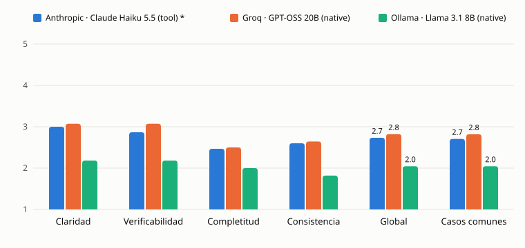

# Reporte de evaluación v1

CriterIA convierte un requerimiento en historias de usuario, criterios de aceptación y casos de prueba con cuatro agentes: Analista, QA, Revisor y un Evaluador que hace de juez. Este reporte compara tres modelos de generación con el mismo grafo, los mismos prompts (v1) y el mismo juez (v1), y mide cuánto se puede confiar en ese juez. El método completo, la configuración y las limitaciones están en [evaluation.md](../evaluation.md).

## Configuración

- **Casos.** 15 requerimientos en español: 5 fáciles, 5 medios y 5 difíciles con 5 problemas sembrados cada uno (ambigüedades, inconsistencias y faltantes).
- **Corridas.** Una corrida por caso y modelo. Las historias se aprueban sin cambios, y hay hasta 2 rondas de corrección del Revisor.
- **Generación.** Temperatura pedida de 0.2; Haiku la ignora. El tope es de 16,384 tokens para los modelos por API y de 8,192 para el local.
- **Juez.** `claude-haiku-5-5`, con rúbrica de 1 a 5 en claridad, verificabilidad, completitud y consistencia, y severo por instrucción.
- **Validación.** Una persona calificó a ciegas 8 corridas (32 pares criterio por corrida). Un emparejador automático decide qué problemas sembrados detectó el Revisor, y la persona revisó 10 de sus decisiones.

| Modelo | Modo de salida | Tope de tokens | Dónde corre |
| --- | --- | --- | --- |
| Anthropic · Claude Haiku 5.5 * | `tool` | 16,384 | API |
| Groq · GPT-OSS 20B | `native` | 16,384 | API; es el modelo del modo gratuito |
| Ollama · Llama 3.1 8B | `native` | 8,192 | RTX 4060 de 8 GB, tiempo límite de 180 s |

\* El juez es del mismo proveedor que este modelo.

## Resultados

| Modelo | Completas | Global (todas) | Global (11 comunes) | Latencia p50 | Costo por corrida (USD) | Problemas detectados |
| --- | --- | --- | --- | --- | --- | --- |
| Haiku 5.5 * | 15 de 15 | 2.73 | 2.70 | 148 s | 0.0296 | 13 de 25 (52%) |
| GPT-OSS 20B | 14 de 15 | 2.82 | 2.82 | 33 s | 0.0089 | 8 de 25 (32%) |
| Llama 3.1 8B | 11 de 15 | 2.05 | 2.05 | 329 s | 0.0015 (solo juez) | 1 de 15 (7%) † |

† Sobre 3 de los 5 casos difíciles; no es directamente comparable. En esos 3 casos, Haiku detecta 9 de 15 y GPT-OSS 4 de 15.

Los 11 casos comunes son los que los tres modelos completaron. El costo de GPT-OSS es un mínimo, porque los rechazos de Groq no devuelven uso.

| Modelo | Claridad | Verificabilidad | Completitud | Consistencia | Válidas a la primera | Errores |
| --- | --- | --- | --- | --- | --- | --- |
| Haiku 5.5 * | 3.00 | 2.87 | 2.47 | 2.60 | 97% | ninguno |
| GPT-OSS 20B | 3.07 | 3.07 | 2.50 | 2.64 | 96% | 1 salida inválida |
| Llama 3.1 8B | 2.18 | 2.18 | 2.00 | 1.82 | 90% | 4 tiempos agotados |

## ¿Cuánto se puede confiar en el juez?

| Medida | Valor (IC 95 %) |
| --- | --- |
| Kappa ponderada, juez contra persona (32 pares) | -0.02 (-0.08 a 0.05) |
| Acuerdo exacto / a ±1 punto | 9% / 38% |
| Juez menos persona, en promedio | -1.78 puntos (-2.09 a -1.47) |
| Juez contra sí mismo al recalificar 10 corridas (kappa / exacto) | 0.74 / 72% |
| Emparejador contra persona | 10 de 10 (69 % a 100 %) |
| Emparejador contra sí mismo (25 decisiones) | 96% |

Las 8 corridas le parecieron de buena calidad a la persona, y le costó distinguirlas: 30 de sus 32 puntajes son 4 o 5. El juez usa casi solo 2 y 3. Con dos rangos estrechos que casi no se tocan, la kappa no puede medir si coinciden en el orden, y el acuerdo exacto y a ±1 es bajo por un desfase sistemático: el juez es severo por diseño y califica casi dos puntos por debajo.

**El juez es estable y sirve para comparar modelos entre sí, pero su escala absoluta no está calibrada con la de una persona.** Un global de 2.7 no significa «regular».

## Conclusiones

1. **Calidad.** Haiku y GPT-OSS 20B quedan parejos según el juez (2.70 contra 2.82 en los casos comunes). La diferencia es menor que el ruido del propio juez, que cambia 1 de cada 4 puntajes al recalificar.
2. **Velocidad y costo.** GPT-OSS 20B es 4.5 veces más rápido y 3.3 veces más barato por corrida que Haiku. Es la elección correcta para el modo gratuito.
3. **Revisión.** Haiku detecta más problemas sembrados (52 % contra 32 %), sobre todo ambigüedades. Los faltantes son el punto débil de los tres modelos: ninguno detectó 7 de los 12.
4. **Modelo local.** Llama 3.1 8B queda claramente detrás en calidad, robustez y velocidad. Es una opción sin costo de generación, no un equivalente.
5. **Método.** Antes de leer los puntajes en escala absoluta hace falta una rúbrica con anclas por nivel y más de un calificador humano.

## Limitaciones

- 15 casos con una corrida cada uno, escritos por el autor del proyecto.
- Un solo juez, del mismo proveedor que Haiku. No hay señales de autopreferencia (Haiku no puntúa por encima de GPT-OSS), pero no se puede descartar.
- Un solo calificador humano: el autor. Solo 8 corridas, con efecto techo.
- El modelo local completó 11 de 15 corridas por su tiempo límite, con un tope de tokens menor.

## Siguiente versión

La v2 cambiará solo los prompts de los agentes, con el juez congelado, y se comparará contra v1 únicamente con Haiku y GPT-OSS 20B, de forma pareada (Wilcoxon). Además, el método incorporará una rúbrica con anclas por nivel, al menos dos calificadores y una muestra con más variedad de calidad.

Costo real de la fase: unos 1.24 USD. De ese total, 0.62 USD corresponden a los resultados que se reportan aquí; el resto se fue en lotes descartados por ajustes de integración y en diagnósticos.
